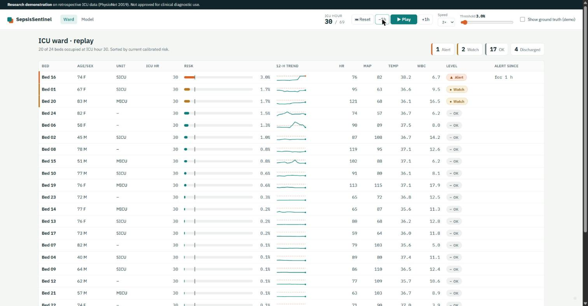
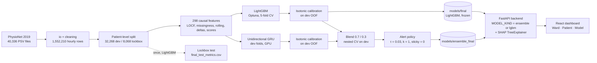
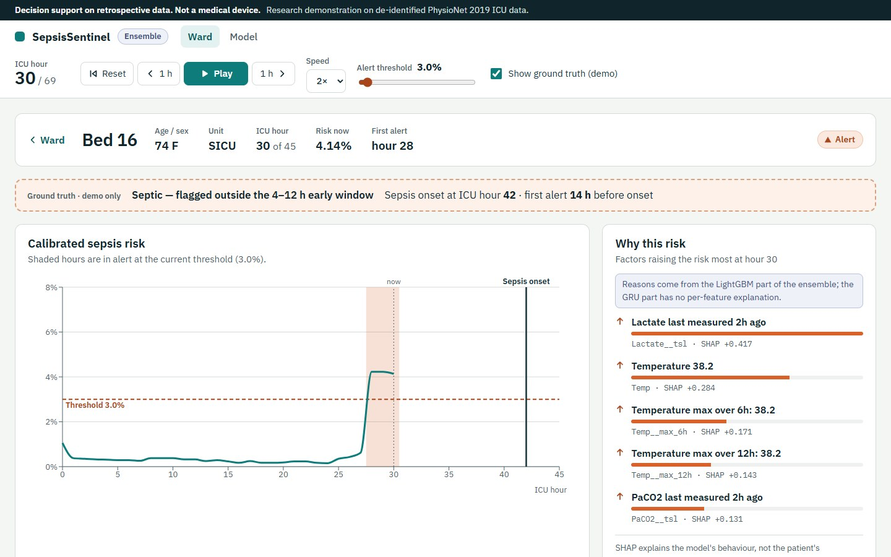
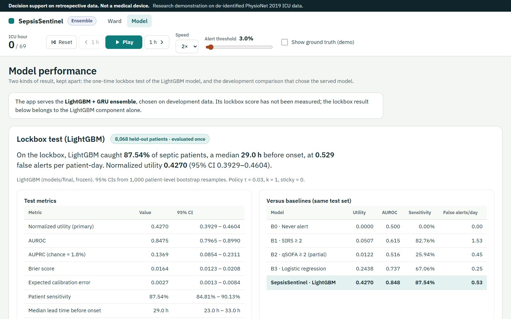

# SepsisSentinel


**Real-time early warning of ICU sepsis on the PhysioNet/Computing in Cardiology Challenge 2019 data, with calibrated risk, SHAP explanations, a cross-hospital generalization study and a replay dashboard.**

**Served model:** a LightGBM + GRU ensemble chosen on development data. Its lockbox score has not been measured; the 0.4270 test result below belongs to the LightGBM component alone. Set `MODEL_KIND=lgbm` to serve LightGBM by itself.

> ⚠️ Decision support on retrospective data. **Not a medical device.** Research demonstration on de-identified ICU data.



---

## Results at a glance

### Lockbox test (LightGBM)

Lockbox test set: **8,068 patients**, evaluated **once**, 95% CIs from 1,000 patient-level bootstrap resamples. These numbers belong to the LightGBM model.

| Metric | LightGBM | 95% CI |
|---|---|---|
| **Normalized utility** (official Challenge score) | **0.4270** | 0.3929 – 0.4604 |
| AUROC | 0.8475 | 0.7965 – 0.8990 |
| AUPRC (chance = 1.79%) | 0.1369 | 0.0854 – 0.2311 |
| Patient sensitivity (alert in [t−12 h, t+3 h]) | 87.54% | 84.81% – 90.13% |
| Median first alert before onset | 29.0 h | 23.0 – 33.0 h |
| False alerts per patient-day | 0.529 | 0.512 – 0.547 |
| Expected calibration error | 0.0027 | 0.0013 – 0.0084 |

| Same test set | Utility | AUROC | Sensitivity | False alerts/day |
|---|---|---|---|---|
| B0 never alert | 0.0000 | 0.500 | 0.00% | 0.00 |
| B1 SIRS ≥ 2 | 0.0507 | 0.615 | 82.76% | 1.53 |
| B2 qSOFA ≥ 2 (partial) | 0.0122 | 0.516 | 25.94% | 0.45 |
| B3 logistic regression | 0.2438 | 0.737 | 67.06% | 0.25 |
| **SepsisSentinel (LightGBM + isotonic)** | **0.4270** | **0.848** | **87.54%** | **0.53** |

### Development comparison (nested 5-fold CV — not lockbox)

On the 32,268 development patients, with calibration, blend weight and policy for each fold fitted on the other four folds:

| Model | Utility | AUROC | Sensitivity | False alerts/day |
|---|---|---|---|---|
| LightGBM | 0.4196 | 0.8421 | 85.46% | 0.478 |
| GRU (hidden 64) | 0.3529 | 0.8119 | 78.13% | 0.400 |
| **Ensemble 0.7 × LightGBM + 0.3 × GRU (served)** | **0.4327** | **0.8466** | **85.00%** | **0.415** |

Paired patient bootstrap: ensemble − LightGBM **+0.0131 [+0.0072, +0.0190]**. Every configuration tried (5 weights × 3 GRU variants) is in `reports/tables/ensemble_dev_*.csv`. These are development numbers; do not compare them with the lockbox table.

### Cross-hospital

**Cross-hospital finding:** a model trained on hospital A loses **32.7%** of its utility on hospital B (0.4405 → 0.2963). Trained on B and tested on A it scores 0.3188, and false alerts nearly triple (0.33 → 0.93/day). Ranking survives (AUROC −0.03 to −0.08); the alert threshold does not.

Full write-up: [`reports/report.md`](reports/report.md) · all tables and figures: [`reports/results.md`](reports/results.md) · model card: [`reports/model_card.md`](reports/model_card.md)

---

## How it works



- **No leakage:** splits by patient; every feature at hour *t* uses hours ≤ *t* (enforced by a prefix-equality test); all fitting on dev data; the lockbox opened once.
- **Primary metric:** the official Challenge normalized utility, reproduced and unit-tested.
- **Calibrated:** isotonic regression, so a displayed 3% risk means about 3%.
- **Explainable:** top-5 SHAP reasons per hour in plain language ("Lactate last measured 2h ago", "Temperature 38.4"), from the LightGBM component.
- **Causal GRU:** the GRU is unidirectional, so hour *t* sees only hours ≤ *t*; a test changes later raw hours and checks that earlier ensemble risks do not move.
- **Same code online and offline:** `src/sepsis/inference.py` serves both the demo cohort and `POST /api/predict` (parity < 1e-6; ensemble online vs batch 4.3e-7). The GRU runs on CPU so results are identical everywhere.

| Patient view | Model view |
|---|---|
|  |  |

---

## Repository layout

```
├── configs/config.yaml          # all paths, seeds, feature and model settings
├── src/sepsis/                  # importable pipeline (python -m sepsis.<module>)
│   ├── io.py cleaning.py eda.py splits.py utility.py metrics.py alerting.py
│   ├── features.py baselines.py train_lgbm.py tune_lgbm.py ablations.py final_model.py
│   ├── cross_hospital.py calibrate.py explain.py evaluate_final.py
│   ├── sequences.py train_gru.py ensemble.py ensemble_final.py
│   ├── inference.py demo_cohort.py report.py
├── tests/                       # pytest for src/sepsis (63 tests)
├── backend/app/                 # FastAPI: main.py, service.py, schemas.py, settings.py
├── backend/tests/test_api.py    # API tests, run for both model kinds (30)
├── frontend/                    # Vite + React + TypeScript + Recharts dashboard
├── models/final/                # frozen LightGBM, calibrator, policy (tracked, 4 MB)
├── models/ensemble_final/       # GRU, GRU calibrator, ensemble.json (tracked, 0.3 MB)
├── data/demo/                   # 24-bed demo cohort (tracked)
├── reports/                     # tables/, figures/, results.md, report.md, model_card.md,
│                                # slides/, demo_script.md, viva_qa.md, qa_checklist.md
├── docker-compose.yml
└── STATUS.md                    # task board, verified numbers, decisions
```

---

## Quick start: run the dashboard

The frozen model and demo cohort are in the repo, so the raw data is **not** needed to run the demo.

### Option A: Docker (recommended)

Requires Docker Desktop (WSL2 backend on Windows).

```bash
docker compose up --build
```

Open **http://localhost:8080**. The API is at http://localhost:8000/api/health (interactive docs at http://localhost:8000/docs). The image installs CPU-only PyTorch for the GRU. To serve LightGBM alone: `MODEL_KIND=lgbm docker compose up --build` (PowerShell: `$env:MODEL_KIND='lgbm'; docker compose up --build`).

### Option B: two terminals

```powershell
# one-time setup
py -3.11 -m venv .venv
.venv\Scripts\Activate.ps1
pip install -r requirements.txt
pip install -e .
cd frontend; npm ci; cd ..

# terminal 1 — API on :8000
.venv\Scripts\python.exe -m uvicorn backend.app.main:app --reload --port 8000

# terminal 2 — UI on :5173 (proxies /api to :8000)
cd frontend; npm run dev
```

Then press **Play** (or Space; ← / → step one hour), open a bed, toggle **Show ground truth**, and move the threshold slider. Deep links such as `/?t=30&truth=1` start the replay at an hour. A guided walkthrough is in [`reports/demo_script.md`](reports/demo_script.md).

### API

| Endpoint | Description |
|---|---|
| `GET /api/health` | status, served model kind and version |
| `GET /api/config` | served model, policy (τ, k, sticky), replay length, disclaimer |
| `GET /api/ward?t=&threshold=` | 24 beds sorted by risk, with level ALERT / WATCH / OK |
| `GET /api/patients/{id}?t=&threshold=&show_truth=` | vitals, labs, risk, alerts, top-5 SHAP reasons |
| `POST /api/predict` | raw hourly rows → cleaning → features → LightGBM (+ GRU) → calibrators → blend → policy |
| `GET /api/metrics` | `lockbox_test` (LightGBM) and `dev_cv` (nested CV comparison) as separate sections, plus cross-hospital and ablation tables |
| `GET /api/model-card` | model card (Markdown + sections) |
| `GET /api/figures/{name}` | selected result figures |

---

## Reproduce the research pipeline

### 1. Get the data

Download the public training sets from PhysioNet (open access): https://physionet.org/content/challenge-2019/1.0.0/

```bash
wget -r -N -c -np https://physionet.org/files/challenge-2019/1.0.0/training/
```

Place the files so that `data/raw/training_setA/` holds 20,336 `.psv` files and `data/raw/training_setB/` holds 20,000.

### 2. Run the phases (from the repo root, venv active)

| Phase | Command | Output |
|---|---|---|
| P1 load | `python -m sepsis.io` | `data/interim/all_rows.parquet` (1,552,210 rows) |
| P1 clean | `python -m sepsis.cleaning` | `clean_rows.parquet`, `cleaning_report.csv` |
| P1 EDA | `python -m sepsis.eda` | EDA tables and figures, adversarial validation |
| P2 splits | `python -m sepsis.splits` | `data/splits/lockbox.csv`, `folds.csv` |
| P3 all | `python -m sepsis.run_phase3` | features, baselines, default/tuned LightGBM, ablations, final model |
| P4 | `python -m sepsis.cross_hospital` | `cross_hospital.csv`, figures |
| P5 calibrate + policy | `python -m sepsis.calibrate` | `calibrator.joblib`, `policy.json`, `threshold_curve.json` |
| P5 SHAP | `python -m sepsis.explain` | SHAP tables and figures |
| P5 **lockbox** | `python -m sepsis.evaluate_final` | `final_test_*.csv`, test figures. ⚠️ **Already run once. Re-running re-opens the test set; don't do it to chase numbers.** |
| P6 GRU (GPU) | `python -m sepsis.sequences`, `python -m sepsis.train_gru` (+ `--alpha 0.5 --hidden 64 --output-dir models/gru_h64`) | `models/gru*/` fold models and OOF |
| P9 selection | `python -m sepsis.ensemble --select` | `reports/tables/ensemble_dev_*.csv`, `ensemble_dev_selection.json` |
| P9 final ensemble | `python -m sepsis.ensemble_final` | `models/ensemble_final/*`, `ensemble_dev_final.csv` |
| P7 demo cohort | `python -m sepsis.demo_cohort` (then `--rescore` for both models) | `data/demo/*` |
| P8 results | `python -m sepsis.report` | `reports/results.md` |

Phase 3 can be run step by step with `python -m sepsis.features`, `sepsis.baselines`, `sepsis.train_lgbm`, `sepsis.tune_lgbm`, `sepsis.ablations`, `sepsis.final_model`, or use the `--skip-*` flags of `run_phase3`. Random seed 42 everywhere. Feature building takes about 5–15 minutes and Optuna about 2–3 hours on a laptop.

### 3. Check

```powershell
.venv\Scripts\python.exe -m pytest                       # 93 tests
.venv\Scripts\python.exe -m ruff check src tests backend
cd frontend; npm run build                               # TypeScript + Vite build
```

---

## Limitations

- Retrospective, de-identified data from two hospitals; the Challenge's hidden hospital C is not public, so external validity is only simulated with A ↔ B transfer.
- Labels come from Sepsis-3 criteria applied to records and are not perfect ground truth.
- The utility-optimal threshold (3%) puts 20.2% of hours in alert (event PPV 4.6%); any threshold trades missed cases against alarm fatigue.
- SHAP explains the model, not causes; measurement-timing features reflect clinician behaviour.
- The served ensemble has no lockbox estimate: its gain over LightGBM (+0.0131 nested utility) is a development-data result, and the GRU variant was the best of three tried on the same folds.
- The demo beds were picked using LightGBM's alerts; the ensemble's outcomes on them are recomputed and shown, not reselected.
- **Not a medical device.**

## Documentation

| Document | Contents |
|---|---|
| [`reports/report.md`](reports/report.md) | full technical report (~7,000 words) |
| [`reports/results.md`](reports/results.md) | auto-generated tables and figures |
| [`reports/model_card.md`](reports/model_card.md) | model card (Mitchell et al., 2019) |
| [`reports/slides/slides.md`](reports/slides/slides.md) | 14-slide Marp deck with speaker notes |
| [`reports/demo_script.md`](reports/demo_script.md) | 3½-minute demo video script |
| [`reports/viva_qa.md`](reports/viva_qa.md) | viva defence Q&A |
| [`reports/qa_checklist.md`](reports/qa_checklist.md) | dashboard QA checklist |
| [`reports/ui_review.md`](reports/ui_review.md) | impeccable critique/audit findings and the UI changes made |
| [`STATUS.md`](STATUS.md) | task board, verified numbers, decisions |

## Citation

Data: Reyna MA, Josef CS, Jeter R, et al. *Early Prediction of Sepsis from Clinical Data: The PhysioNet/Computing in Cardiology Challenge 2019.* Crit Care Med. 2020;48(2):210–217. Goldberger AL, et al. *PhysioBank, PhysioToolkit, and PhysioNet.* Circulation. 2000;101(23):e215–e220.

Author: Amaan Surti — DSML Final Project, NUV, 2026.
