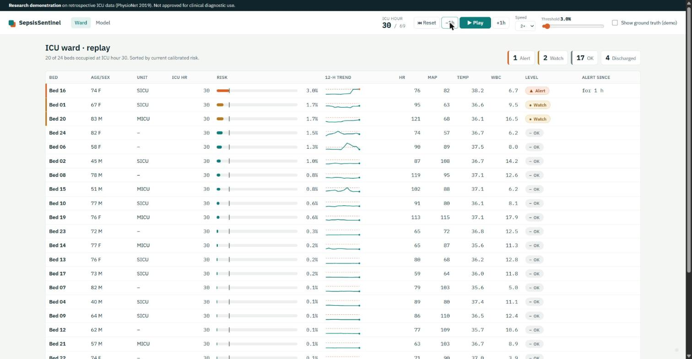
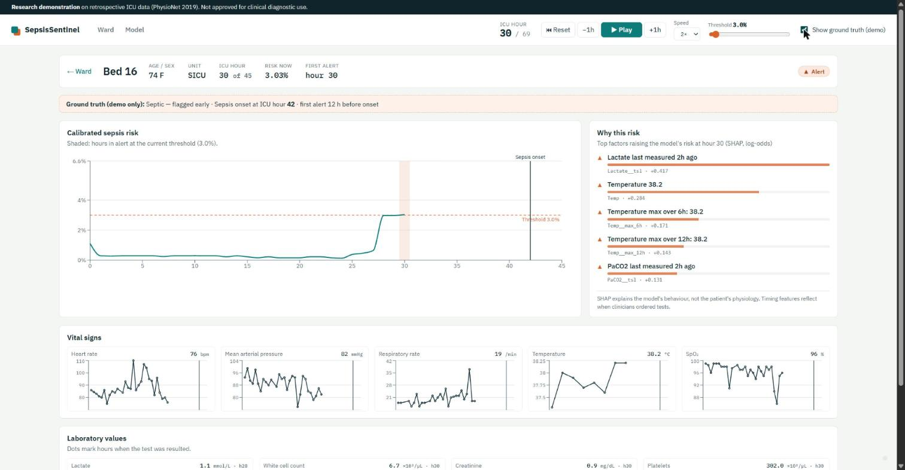
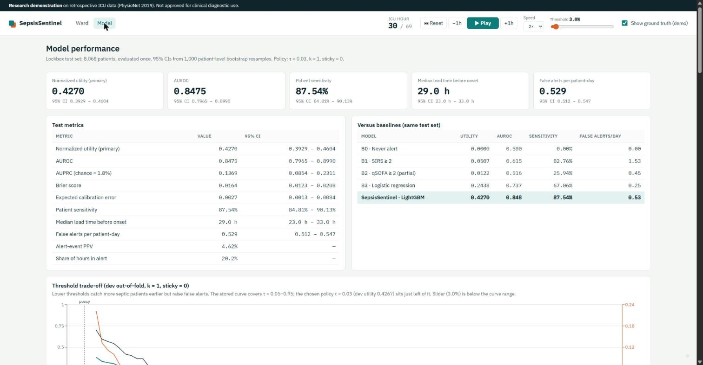

# SepsisSentinel: A Calibrated, Explainable Early-Warning System for ICU Sepsis, and What Happens When It Changes Hospitals

**Amaan Surti** — Data Science and Machine Learning, Semester 7 Final Project, NUV — October 2026

*Code, tables and figures: this repository. Every number in this report is copied from `reports/tables/` or `STATUS.md`; the lockbox test set was evaluated exactly once.*

---

## Abstract

Sepsis is a leading cause of death in intensive care, and every hour of delayed treatment raises mortality. We built SepsisSentinel, a real-time early-warning system trained on the PhysioNet/Computing in Cardiology Challenge 2019 data (40,336 ICU patients from two hospitals, 1,552,210 hourly rows, 7.27% septic). From the 40 hourly variables we derive 298 strictly causal features, train a LightGBM model tuned with Optuna, calibrate it with isotonic regression, and choose an alert threshold that maximises the official Challenge utility score. On a lockbox test set of 8,068 patients, evaluated once, the system reaches a normalized utility of 0.4270 (95% CI 0.3929–0.4604), AUROC 0.8475, and patient-level sensitivity of 87.54%, with a median first alert 29.0 h before onset at 0.53 false alert events per patient-day. Calibration error is 0.0027. It clearly outperforms SIRS (utility 0.0507), qSOFA (0.0122) and logistic regression (0.2438). However, when a model trained on one hospital is applied to the other, utility falls by up to 32.7%. We release a FastAPI and React dashboard that replays test patients with SHAP explanations.

---

## 1. Introduction

### 1.1 Sepsis and why time matters

Sepsis is life-threatening organ dysfunction caused by a dysregulated host response to infection (Sepsis-3; Singer et al., 2016). It accounted for an estimated 48.9 million cases and 11 million deaths worldwide in 2017, about one in five deaths globally (Rudd et al., 2020). Septic shock is the subset in which circulatory and metabolic abnormalities are severe enough to substantially increase mortality.

Outcomes depend strongly on how quickly treatment starts. In a landmark retrospective study of septic shock, each hour of delay in effective antimicrobial therapy after the onset of hypotension was associated with a measurable drop in survival (Kumar et al., 2006). This is the logic behind the sepsis "golden hours" and the bundles of care (cultures, lactate, antibiotics, fluids) that guidelines ask clinicians to deliver within the first hour of recognition. The bottleneck is often recognition itself: early sepsis is non-specific, develops over hours, and is buried in a stream of vital signs and laboratory results that no clinician can watch continuously for every patient.

### 1.2 Clinical definitions used for labels and baselines

- **SIRS** (Bone et al., 1992): two or more of temperature > 38 °C or < 36 °C, heart rate > 90/min, respiratory rate > 20/min or PaCO2 < 32 mmHg, white cell count > 12 or < 4 ×10³/µL. Sensitive, but triggered by many non-infectious states.
- **SOFA** (Sequential Organ Failure Assessment): organ-dysfunction score over respiratory, coagulation, liver, cardiovascular, CNS and renal systems. Sepsis-3 defines sepsis as suspected infection plus an acute increase of ≥ 2 SOFA points.
- **qSOFA** (Seymour et al., 2016): respiratory rate ≥ 22, systolic BP ≤ 100 mmHg, altered mentation. Intended as a bedside prompt outside the ICU.

The PhysioNet 2019 labels apply Sepsis-3 to the records: onset time *t_sepsis* is derived from the timing of suspected infection (cultures plus antibiotics) and the SOFA increase. The Challenge then marks `SepsisLabel = 1` from **6 hours before** *t_sepsis* onward, so a model that predicts the label is asked to anticipate onset by about six hours.

### 1.3 Early warning and alarm fatigue

An early-warning system is only useful if clinicians act on it. ICU staff already face a high volume of monitor alarms, most of which are false or not clinically actionable, and excessive alarms lead to desensitisation and missed true events (alarm fatigue; Sendelbach & Funk, 2013). Sepsis alerts that fire too often will be ignored; alerts that fire too late are useless. So a model's quality cannot be summarised by AUROC alone. We need to know how many septic patients are flagged, how early, and how many false alerts each clinician receives per patient-day. The Challenge utility function (§4.2) encodes this trade-off explicitly, and we report clinical alerting metrics alongside it.

### 1.4 Contributions

1. A strictly causal, leakage-tested feature pipeline (298 features) and a tuned, calibrated LightGBM model evaluated under a single-use lockbox protocol with patient-level bootstrap confidence intervals.
2. An explicit alert policy optimised for the official utility, with sensitivity, lead time, false-alert burden and event PPV reported side by side.
3. A cross-hospital study (train on one hospital, test on the other, four feature variants) that quantifies how much performance survives a change of site.
4. Global and per-hour SHAP explanations, a subgroup analysis, and an end-to-end product (FastAPI, React dashboard, Docker) that replays real test patients.

---

## 2. Related Work

**The PhysioNet/CinC Challenge 2019.** Reyna et al. (2020) released hourly ICU data from three hospital systems: two public training sets (A and B, the data used here) and a hidden test set including a third hospital (C). Teams were ranked by a clinical utility score that rewards early true alerts and penalises false and late ones. The best official normalized utility on the full hidden test set was 0.360. A central finding was that performance dropped markedly on hospital C, which contributed no training data, a warning about how well such models generalise to new sites. Our scores are **not** directly comparable to the leaderboard: our test patients come from the same two hospitals as our training data, which is an easier setting than the hidden-hospital test.

**Gradient boosting dominated the Challenge.** Many top entries used gradient-boosted trees over hand-crafted temporal features (rolling statistics, differences, measurement indicators), often outperforming recurrent networks. The winning team (Morrill et al., 2019) combined path-signature features with gradient boosting. LightGBM (Ke et al., 2017) adds histogram-based splits and leaf-wise growth, making it efficient on millions of rows and tolerant of missing values, which is the regime here.

**Generalisation failures in deployed sepsis models.** External validation of a widely deployed proprietary sepsis model found much lower discrimination than the developer reported, and alerts that missed many cases while firing on a large share of hospitalised patients (Wong et al., 2021). More generally, clinical prediction models often fail to transfer across sites because of differences in populations, documentation practice and measurement frequency (Futoma et al., 2020). This motivates our Phase 4 cross-hospital study.

**Calibration.** Boosted trees trained with class weighting produce poorly calibrated scores. Isotonic regression (Zadrozny & Elkan, 2002) is a non-parametric monotone mapping that works well with large calibration sets (Niculescu-Mizil & Caruana, 2005).

**Explainability.** SHAP (Lundberg & Lee, 2017) attributes a prediction to features using Shapley values; TreeSHAP computes them exactly and quickly for tree ensembles (Lundberg et al., 2020).

**Deep sequence models and focal loss.** Recurrent networks are a natural fit for hourly sequences, and focal loss (Lin et al., 2017) down-weights easy negatives under extreme imbalance. Our build plan includes an optional GRU with focal loss (Phase 6); it was **not run** for this report (§6.10).

---

## 3. Data

### 3.1 Source and cohort

We use the public training sets of the PhysioNet/CinC Challenge 2019 (Reyna et al., 2020): one pipe-separated file per patient, one row per ICU hour, 40 clinical variables plus `SepsisLabel`. The variables are 8 vital signs (HR, O2Sat, Temp, SBP, MAP, DBP, Resp, EtCO2), 26 laboratory values, and 6 demographic/administrative fields (Age, Gender, Unit1, Unit2, HospAdmTime, ICULOS).

**Table 1. Cohort (all 40,336 patients).**

| | Hospital A | Hospital B | Total |
|---|---|---|---|
| Patients | 20,336 | 20,000 | 40,336 |
| Hourly rows | 790,215 | 761,995 | 1,552,210 |
| Septic patients | 1,790 (8.80%) | 1,142 (5.71%) | 2,932 (7.27%) |
| Positive rows (`SepsisLabel = 1`) | 17,136 (2.17%) | 10,780 (1.41%) | 27,916 (1.80%) |
| Median ICU stay (h) [Q1–Q3] | 39 [25–47] | 38 [23–47] | 38 [24–47] |
| Median age (years) | 64.7 | 62.0 | 63.1 |
| Male | 58.19% | 53.66% | 55.95% |

### 3.2 Cleaning

Physiologically impossible values were set to missing using fixed ranges (e.g. HR 20–300/min, Temp 25–45 °C, pH 6.5–8.0, Lactate 0.1–30 mmol/L). FiO2 recorded as a percentage was converted to a fraction, and values outside 0.21–1.0 were removed. No variable lost more than 0.31% of its observed values (FiO2: 395 of 129,365). The two unit indicators were merged into one categorical `unit` (1 = MICU, 2 = SICU, 0 = unknown). No backward filling or imputation from the future was done.

### 3.3 Missingness

Missingness is extreme and structured. Vital signs are mostly hourly (HR missing in 9.9% of hours), temperature is missing in 66.2% of hours, and most laboratory values are missing in more than 90% of hours (e.g. HCO3 95.8%, FiO2 91.7%). EtCO2 is missing in 100% of hospital-A hours and 92.4% of hospital-B hours. Missingness patterns differ sharply between hospitals: DBP is missing in 48.1% of A hours vs 14.0% of B hours, and BaseExcess in 89.6% vs 99.8%. A test that is ordered tells us something about what the clinician was worried about, so we treat missingness as information rather than noise (§4.3).

### 3.4 Label construction

For septic patients, *t_sepsis* = (index of the first hour with `SepsisLabel = 1`) + 6. Non-septic patients are labelled 0 throughout. About 1.8% of hours are positive, so a classifier that never alerts is 98.2% "accurate", which is why accuracy is never reported.

### 3.5 The two hospitals are easy to tell apart

We trained a LightGBM classifier to predict the hospital from per-patient summaries (mean value and percentage missing per variable). It reaches **AUROC = 1.0000** (0.99997): the hospitals are perfectly separable. The strongest signals are documentation patterns, mainly HCO3 missingness (gain 412,941, an order of magnitude ahead of everything else), then EtCO2 mean, DBP mean, BaseExcess missingness and DBP missingness. Kolmogorov–Smirnov tests on observed values show the largest distribution shifts for Troponin I (KS = 0.534), direct bilirubin (0.475), SaO2 (0.306) and BaseExcess (0.300). This sets up the Phase 4 question: a model that learns from these patterns may be learning the hospital as well as the patient.

---

## 4. Methods

### 4.1 Splits and the lockbox protocol

All splits are by patient. Rows from one patient never appear in two splits.

- **Lockbox test:** 20% of patients (8,068), stratified by hospital × septic status, seed 42. The lockbox was not opened until the single final evaluation (Phase 5.T6).
- **Development:** the remaining 32,268 patients, divided into 5 stratified folds (septic rate per fold within ±0.5 pp, hospital share within ±1 pp). Every fitted object (model, hyperparameters, early-stopping round, calibrator, alert threshold) was chosen using dev data only.
- **Cross-hospital folds:** for Phase 4, each hospital is split into its own 5 internal folds.

### 4.2 Primary metric: the official normalized utility

For each patient and each hour, the utility function scores the binary alert:

- **Septic patients.** An alert between 12 h before and 3 h after *t_sepsis* earns positive credit. The credit rises linearly from 0 at *t* − 12 to the maximum of +1 at *t* − 6 and stays at +1 until *t* + 3. An alert earlier than *t* − 12 costs −0.05, like a false alarm. A **missed** hour from *t* − 6 to *t* + 3 costs up to −2 (linearly increasing penalty), so failing to alert near onset is twice as bad as a perfectly timed alert is good.
- **Non-septic patients.** Every alert hour costs −0.05; no alert scores 0.

The total is normalised so that a never-alerting system scores 0 and an oracle that alerts exactly in the optimal window scores 1: U_norm = (U_model − U_inaction) / (U_optimal − U_inaction). The scorer was reproduced from the official reference implementation and checked against 8 hand-computed cases.

Secondary metrics:
- **AUROC / AUPRC** at the hourly level (AUPRC chance level = prevalence, 1.79% on the test set);
- **Brier score** and **ECE** (10 equal-width bins) for calibration;
- **Patient sensitivity:** share of septic patients with ≥ 1 alert in [*t* − 12, *t* + 3];
- **Median lead time:** *t_sepsis* − (first alert hour within [*t* − 48, *t* + 3]);
- **False alerts per patient-day:** number of alert *events* (rising edges) in non-septic patients divided by their total patient-days;
- **Event PPV:** share of alert events that start inside a septic patient's [*t* − 12, *t* + 3] window;
- **Alert-hour rate:** share of all hours spent in alert.

Confidence intervals: 1,000 bootstrap resamples of **patients** (not rows), seed 42.

### 4.3 Causal feature engineering

Each feature at hour *t* uses only rows with hour ≤ *t*. Let *x_raw* be the cleaned value (missing if not measured that hour) and *x_locf* its last observation carried forward within the patient.

**Table 2. Feature families (298 features).**

| Family | Count | Definition |
|---|---|---|
| F1 Current values | 34 | *x_locf* for every vital and lab |
| F2 Measured flag | 34 | 1 if measured this hour |
| F3 Hours since last measurement | 34 | capped at 72 h (cap also used if never measured) |
| F4 24-h lab counts | 26 | number of results in hours *t* − 23 … *t* |
| F5 Rolling statistics | 137 | 7 vitals × {6, 12, 24 h} × {mean, min, max, std, slope} = 105; 8 key labs × 24 h × {mean, min, max, slope} = 32; computed on observed values only |
| F6 6-h differences | 7 | *x_locf*(*t*) − *x_locf*(*t* − 6) |
| F7 Baseline deltas | 11 | *x_locf*(*t*) − mean of the patient's observed values in hours 0–5 (built only from data available so far) |
| F8 Clinical indices | 6 | shock index HR/SBP, modified shock index HR/MAP, pulse pressure, BUN/creatinine, SpO2/FiO2, 6-h slope of shock index |
| F9 Clinical scores | 4 | SIRS (0–4), partial qSOFA (0–2, no mentation), partial SOFA (0–13: coagulation, liver, renal, MAP), 24-h SOFA change |
| F10 Static | 5 | age, sex, unit, hospital-admission time, ICU hour |

Slopes are least-squares slopes of value against hour over the observed points in the window, computed in a vectorised way from rolling sums. `hospital`, `patient_id`, `Unit1`, `Unit2` and the label are excluded from the feature list.

**Leakage tests (mandatory acceptance tests).** (1) For 20 random patients, features computed on the full stay equal features computed on a random prefix of the stay, for every row in the prefix. If any feature looked ahead, the two would differ. (2) A hand-built 8-hour patient checks LOCF, measured flags, time-since-last (0, 0, 1, 0, 1, 2, 0, 0), a 6-h mean, and a 6-h slope against `numpy.polyfit`. (3) Score checks: SIRS = 4 and partial SOFA = 5 on hand-made rows. (4) The feature list contains no forbidden names. All pass, along with the rest of the 67-test suite.

### 4.4 Models

**Baselines.**
- **B0** never alerts (utility 0 by definition).
- **B1** alerts when SIRS ≥ 2.
- **B2** alerts when partial qSOFA ≥ 2.
- **B3** standardised logistic regression on 73 features (34 LOCF values, 34 measured flags, SIRS, partial SOFA, shock index, age, sex), with its own alert policy chosen on dev OOF (τ = 0.72, k = 1, sticky = 6).

**LightGBM.** Binary objective, early stopping on validation average precision (patience 200), seed 42, deterministic mode. Default parameters (learning rate 0.03, 63 leaves, min child samples 200, scale_pos_weight 5) were first evaluated with 5-fold CV. **Optuna** (TPE sampler, seed 42) then ran 40 trials over learning rate [0.01, 0.1], num_leaves [15, 255], min_child_samples [20, 1000], feature_fraction [0.4, 1.0], bagging_fraction [0.5, 1.0], λ₂ [10⁻³, 10] and scale_pos_weight [1, 20], maximising mean validation AUPRC over dev folds 0–2. The best trial (13) reached AUPRC 0.1342 vs 0.1264 for the defaults, with learning rate 0.0102, 126 leaves, min child samples 847, feature fraction 0.897, bagging fraction 0.517, λ₂ 0.301 and scale_pos_weight 2.79. The **final model** was trained on all 1,241,132 dev rows for 303 rounds (1.1 × the mean best iteration of 275.6 across the 5 folds).

### 4.5 Calibration

Class weighting and early stopping on AUPRC distort probabilities. We fitted `IsotonicRegression(out_of_bounds="clip")` on the tuned model's dev out-of-fold probabilities, so the calibrator never saw a prediction made on its own training rows. The deployed score is calibrated risk = isotonic(LightGBM(x)).

### 4.6 Alert policy

Calibrated risk is turned into alerts with three parameters:
1. **Threshold** τ: alert when risk ≥ τ.
2. **Persistence k:** require k consecutive hours above τ.
3. **Sticky hours s:** keep the alert on for s hours after it fires.

We searched τ ∈ {0.01, …, 0.99}, k ∈ {1, 2, 3}, s ∈ {0, 6} (594 configurations) on calibrated dev OOF predictions, maximising normalized utility (ties broken towards the higher threshold). The policy is causal: the alert at hour *t* depends only on risks up to *t* (unit-tested).

### 4.7 Explainability

`shap.TreeExplainer` on the final booster. Global importance uses all rows of 300 random septic dev patients plus 20,000 random non-septic dev rows (38,895 rows). Per-hour explanations keep the five largest **positive** SHAP contributions and translate each into plain language through the feature naming convention: for example `Lactate__tsl = 2` becomes "Lactate last measured 2h ago", and `Temp__max_6h = 38.2` becomes "Temperature max over 6h: 38.2". Stability: the top-10 features of each of the 5 fold models are compared by pairwise Jaccard index.

### 4.8 Cross-hospital design

For each feature variant we (i) run 5-fold CV inside hospital A and inside hospital B, each with its own calibration and alert policy ("internal"), and (ii) train on all of one hospital and test on all of the other, carrying over the source hospital's calibrator and policy ("external", A → B and B → A). The variants are:

| Variant | Change |
|---|---|
| R0 | Full 298 features |
| R1 | Remove missingness features (F2, F3, F4) |
| R2 | Standardise each variable within each hospital (unsupervised z-score per site) |
| R3 | Remove administrative timing (`HospAdmTime`, ICU hour) |

---

## 5. Development Results (dev out-of-fold)

**Table 3. Dev OOF, 32,268 patients.**

| Model | Utility | AUROC | AUPRC | Sensitivity | Median lead (h) | False alerts/day | Policy (τ, k, s) |
|---|---|---|---|---|---|---|---|
| B0 never alert | 0.0000 | 0.500 | 0.0180 | 0.00% | – | 0.00 | – |
| B1 SIRS ≥ 2 | 0.0519 | 0.613 | 0.0249 | 83.03% | 25.0 | 1.51 | rule |
| B2 qSOFA ≥ 2 | 0.0153 | 0.518 | 0.0192 | 27.83% | 17.0 | 0.45 | rule |
| B3 logistic regression | 0.2528 | 0.743 | 0.0582 | 66.03% | 22.0 | 0.24 | 0.72, 1, 6 |
| LightGBM default | 0.4183 | 0.8446 | 0.1221 | 83.55% | 24.0 | 0.44 | 0.10, 1, 0 |
| LightGBM tuned | 0.4262 | 0.8447 | 0.1223 | 86.10% | 24.0 | 0.48 | 0.05, 1, 0 |
| LightGBM tuned + isotonic | 0.4267 | – | – | – | – | – | **0.03, 1, 0** |

Tuning barely moved AUROC (0.8446 → 0.8447) but improved utility (0.4183 → 0.4262) and calibration (ECE 0.0412 → 0.0182 before isotonic). After isotonic calibration the dev ECE was 0.0000 (in-sample for the calibrator) and Brier fell from 0.0177 to 0.0166. The utility-optimal policy on calibrated scores was **τ = 0.03, k = 1, s = 0** (dev utility 0.4267). Persistence and sticky hours did not help: the utility function already penalises every false-alert hour, and a single hour above 3% risk is informative enough.

**Ablations (Table 4).** Removing the missingness families caused by far the largest loss, confirming that *when* something is measured carries signal.

**Table 4. Feature-group ablations (dev OOF, tuned parameters).**

| Variant | Features | Utility | Δ utility | AUROC | AUPRC |
|---|---|---|---|---|---|
| Full | 298 | 0.4262 | – | 0.8447 | 0.1223 |
| − missingness (F2–F4) | 204 | 0.4039 | −0.0223 | 0.8340 | 0.1173 |
| − rolling statistics (F5) | 160 | 0.4205 | −0.0057 | 0.8445 | 0.1186 |
| − differences and baseline deltas (F6–F7) | 280 | 0.4231 | −0.0030 | 0.8458 | 0.1257 |
| − indices and scores (F8–F9) | 288 | 0.4234 | −0.0028 | 0.8454 | 0.1207 |

Rolling statistics, deltas and clinical indices each add a little; gradient boosting can partly rebuild them from raw values. Missingness information cannot be rebuilt from the LOCF values, and removing it costs 5.2% of the utility.

---

## 6. Lockbox Test Results

### 6.1 Headline performance

The final pipeline (`models/final/lgbm.txt` → isotonic calibrator → policy τ = 0.03, k = 1, s = 0) was applied once to the 8,068 lockbox patients.

**Table 5. Lockbox test, 8,068 patients, 95% patient-bootstrap CIs.**

| Metric | Value | 95% CI |
|---|---|---|
| **Normalized utility** | **0.4270** | 0.3929 – 0.4604 |
| AUROC | 0.8475 | 0.7965 – 0.8990 |
| AUPRC | 0.1369 | 0.0854 – 0.2311 |
| Brier score | 0.0164 | 0.0123 – 0.0208 |
| ECE (10 bins) | 0.0027 | 0.0013 – 0.0084 |
| Patient sensitivity | 87.54% | 84.81% – 90.13% |
| Median lead time | 29.0 h | 23.0 – 33.0 h |
| False alerts per patient-day | 0.529 | 0.512 – 0.547 |
| Event PPV | 4.62% | – |
| Hours in alert | 20.2% | – |

Test utility (0.4270) is almost identical to dev OOF utility (0.4267, +0.0003), so there is no sign of overfitting to the development data. The result is below the 0.6 "too good to be true" leakage alarm set in the build plan. AUROC (0.8475) is likewise close to dev (0.8447).

### 6.2 Why AUPRC looks low

An AUPRC of 0.137 can look poor, but AUPRC's chance level equals the prevalence of positive hours, which is 1.79% on the test set. The model is **7.6 times** better than chance. Hourly AUPRC is also a harsh target here: a septic patient contributes many positive hours, and the hours just after the label switches on are hard to tell apart from the hours just before.

### 6.3 Comparison with baselines

**Table 6. Baselines vs SepsisSentinel on the same test set.**

| Model | Utility | AUROC | AUPRC | Sensitivity | Median lead (h) | False alerts/day | Event PPV |
|---|---|---|---|---|---|---|---|
| B0 never alert | 0.0000 | 0.500 | 0.0179 | 0.00% | – | 0.00 | – |
| B1 SIRS ≥ 2 | 0.0507 | 0.615 | 0.0249 | 82.76% | 27.0 | 1.53 | 3.06% |
| B2 qSOFA ≥ 2 | 0.0122 | 0.516 | 0.0190 | 25.94% | 20.0 | 0.45 | 4.28% |
| B3 logistic regression | 0.2438 | 0.737 | 0.0556 | 67.06% | 24.0 | 0.25 | 7.13% |
| **SepsisSentinel** | **0.4270** | **0.848** | **0.1369** | **87.54%** | **29.0** | **0.53** | **4.62%** |

SIRS catches nearly as many septic patients (82.76%), but at almost three times the false-alert rate (1.53 per patient-day) and with an alert on 30.9% of all hours, so its utility is near zero (0.0507). Partial qSOFA is quiet but misses three quarters of patients. Logistic regression is the strongest baseline. SepsisSentinel improves its utility by 75% relative (0.2438 → 0.4270) and catches 20 percentage points more septic patients. B3 has fewer false alerts and a higher event PPV because its dev-chosen threshold is more conservative; the utility function judged that trade worse.

### 6.4 Calibration

On the untouched test set the calibrated model has ECE 0.0027 and Brier 0.0164, against uncalibrated values of 0.0221 and 0.0179 (reliability figure `fig_calibration_test.png`). Most predicted risks are small (below 5%), as expected with 1.8% prevalence; the sparse high-risk bins are noisier. Calibration matters for the product: a displayed risk of 3% genuinely means about 3 in 100 such patient-hours carry the label, so the threshold slider in the dashboard is in interpretable units.

### 6.5 Lead time: early, but read carefully

The median first alert comes 29.0 h before onset (95% CI 23–33 h), measured within a 48-h look-back window. Two caveats:
1. The low threshold (3%) means 20.2% of all hours are in alert. Some septic patients are flagged early in their stay and stay flagged; an alert 29 h ahead is less specific than one 6 h ahead.
2. The utility function gives no credit for alerts earlier than *t* − 12 and charges them −0.05 per hour, so long lead times are not what drives the utility score. Sensitivity within [*t* − 12, *t* + 3] (87.54%) is the more relevant figure for timely recognition.

### 6.6 Alert burden

0.53 false alert events per non-septic patient-day is roughly one new false alert every 45 hours per patient, or about 13 per day across a 24-bed unit of non-septic patients. Event PPV is 4.6%: about 1 in 22 alert events starts in a septic patient's actionable window. This is better than SIRS (3.1%) but it is the price of high sensitivity, and any deployment would need local tuning (§9.3).

### 6.7 Subgroups

**Table 7. Lockbox test by subgroup.**

| Subgroup | Utility | AUROC | Sensitivity | Median lead (h) | False alerts/day |
|---|---|---|---|---|---|
| Hospital A | 0.4376 | 0.827 | 87.71% | 31.0 | 0.66 |
| Hospital B | 0.4099 | 0.866 | 87.28% | 21.0 | 0.40 |
| Female | 0.3798 | 0.837 | 85.52% | 26.0 | 0.53 |
| Male | 0.4554 | 0.853 | 88.77% | 31.0 | 0.53 |
| Age < 45 | 0.3689 | 0.826 | 88.64% | 33.5 | 0.57 |
| Age 45–64 | 0.4246 | 0.851 | 88.04% | 25.5 | 0.51 |
| Age 65–79 | 0.4830 | 0.870 | 89.42% | 31.0 | 0.51 |
| Age ≥ 80 | 0.3514 | 0.799 | 80.25% | 29.0 | 0.57 |

Sensitivity is similar across hospitals and sexes (85–89%), and the false-alert rate is the same for women and men (0.53). Patients aged 80 and over have the lowest sensitivity (80.25%) and AUROC (0.799). The female–male utility gap on the test set (0.380 vs 0.455) is **not** seen in dev OOF (0.423 vs 0.429). Likewise the < 45 band is the best band in dev (0.476) but among the worst on test (0.369). Subgroup test sets contain only a few dozen to a few hundred septic patients, so these swings are largely sampling noise. We did not compute per-subgroup CIs, and we treat the subgroup results as a monitoring signal rather than a conclusion. The consistent pattern is weaker performance in the very elderly and a higher alert burden at hospital A.

### 6.8 Explainability

**Table 8. Top global features (mean |SHAP|, log-odds).**

| Rank | Feature | Meaning | Mean |SHAP| |
|---|---|---|---|
| 1 | `static__iculos` | ICU hour (time in ICU) | 0.547 |
| 2 | `FiO2__tsl` | hours since FiO2 last recorded | 0.290 |
| 3 | `static__hosp_adm_time` | hours between hospital and ICU admission | 0.134 |
| 4 | `static__unit` | ICU unit | 0.072 |
| 5 | `Lactate__tsl` | hours since lactate last measured | 0.057 |
| 6 | `Temp` | current temperature | 0.055 |
| 7 | `Temp__max_12h` | 12-h max temperature | 0.048 |
| 8 | `BUN` | urea | 0.048 |
| 9 | `WBC` | white cell count | 0.047 |
| 10 | `idx__shock_index` | HR / SBP | 0.045 |

Two kinds of signal dominate:
1. **Time and care-process features.** Time in ICU matters because sepsis labels are concentrated later in longer stays (onset timing figure), and being in ICU longer is itself a marker of severity. Time since FiO2 and lactate were recorded reflects clinical concern: a recently ordered lactate is often part of a sepsis work-up.
2. **Physiology consistent with Sepsis-3 and SIRS:** fever (temperature and its 6- and 12-h maxima), WBC, renal markers (BUN, creatinine), shock index and SIRS count.

The top-10 sets are moderately stable across fold models (mean pairwise Jaccard 0.594, range 0.43–0.82).

These explanations describe the model, not the patient. A high attribution to "lactate last measured 2 h ago" means the model uses the act of ordering, which a clinician already knows about. It does not mean the lactate value is abnormal. This is useful transparency (it exposes shortcut-like reliance on care processes) but it is not causal evidence.

### 6.9 Cross-hospital generalization

**Table 9. Internal CV vs zero-shot transfer.**

| Variant | A internal | A → B | B internal | B → A |
|---|---|---|---|---|
| R0 full | 0.4405 | 0.2963 | 0.3759 | 0.3188 |
| R1 no missingness | 0.4231 | 0.2931 | 0.3940 | 0.3146 |
| R2 per-site standardised | 0.4349 | 0.2882 | 0.3546 | 0.3224 |
| R3 no admin timing | 0.3821 | 0.2502 | 0.3737 | 0.2903 |

**Table 10. R0 transfer in clinical terms.**

| Setting | AUROC | Sensitivity | False alerts/day | Median lead (h) |
|---|---|---|---|---|
| A internal | 0.830 | 84.69% | 0.54 | 27.0 |
| A → B | 0.802 | 66.29% | 0.29 | 24.0 |
| B internal | 0.857 | 76.62% | 0.33 | 20.0 |
| B → A | 0.777 | 91.56% | 0.93 | 29.0 |

Findings:
1. **Large drop on transfer.** Compared with a model trained and tested at the same hospital, utility falls by 32.7% when an A-trained model is used at B (0.4405 → 0.2963). Using a B-trained model at A gives 0.3188, which is 15.2% below B's own internal score (0.3759) and 27.6% below what an A-trained model achieves at A (0.4405).
2. **Discrimination degrades only moderately; the operating point is the main failure.** AUROC falls by just 0.03–0.08. Most of the utility loss comes from a threshold that is wrong for the new site. A's policy applied to B is too conservative: sensitivity collapses from 84.7% to 66.3%. B's policy (τ = 0.03) applied to A is too permissive: sensitivity rises to 91.6% but false alerts nearly triple to 0.93 per patient-day. This is the typical failure of a deployed early-warning score. The ranking survives; the alert rate does not.
3. **Missingness is not the culprit.** Removing missingness features (R1) leaves the transfer gap essentially unchanged (A → B 0.2931 vs 0.2963), even though missingness patterns are what make the hospitals perfectly separable. The shift is in the relationship between features and outcome as well as in the documentation.
4. **Per-site standardisation does not fix it.** Aligning feature distributions with unlabelled target data (R2) gives A → B 0.2882 and B → A 0.3224: simple covariate alignment cannot correct label or practice shift.
5. **Timing features help everywhere.** Removing ICU hour and admission time (R3) lowers internal and external utility alike (A internal 0.3821, A → B 0.2502). These features are not merely site artefacts; stay progression is genuine context.

Practical conclusion: a sepsis model should not be moved to a new hospital without, at minimum, re-tuning the alert threshold on local data, and preferably local recalibration and a silent-mode trial.

### 6.10 Deep-learning comparison (not performed)

The optional GRU with focal loss (build plan Phase 6) was not run, so this report makes no claim about LightGBM versus deep sequence models on this data beyond what the Challenge literature reports. The API serves LightGBM regardless.

---

## 7. Product Architecture

### 7.1 Overview

```
 ┌──────────────────────────── offline (Phases 1–5) ───────────────────────────┐
 │ PSV files → io → cleaning → features (298, causal) → LightGBM (Optuna)       │
 │        → isotonic calibrator → policy search → models/final/  (frozen)       │
 │ lockbox test patients (stay 24–96 h) → demo_cohort → data/demo/ (24 beds)    │
 └──────────────────────────────────────────────────────────────────────────────┘
                                   │ loaded once at startup (lifespan)
 ┌───────────────────────── backend (FastAPI, :8000) ───────────────────────────┐
 │ SepsisService: booster · calibrator · policy · TreeExplainer · demo tables   │
 │ GET /api/health  /api/config  /api/ward  /api/patients/{id}  /api/metrics     │
 │ GET /api/model-card  /api/figures/{name}   POST /api/predict (online path)    │
 └──────────────────────────────────────────────────────────────────────────────┘
                                   │ JSON over /api (nginx proxy in Docker)
 ┌──────────────────── frontend (React + TypeScript + Recharts) ────────────────┐
 │ ReplayContext (clock, speed, threshold, show-truth)                          │
 │ Ward page · Patient page (risk, vitals, labs, SHAP reasons) · Model page      │
 └──────────────────────────────────────────────────────────────────────────────┘
```

### 7.2 Demo cohort

From lockbox test patients with stays of 24–96 h, after applying the frozen model and policy, 24 beds were drawn with seed 42:
- 8 septic patients flagged early (first alert 4–12 h before onset);
- 2 septic patients missed or flagged late;
- 10 non-septic patients with no alerts;
- 4 non-septic patients with at least one false alert.

Bed numbers are shuffled. Including misses and false alarms is deliberate, so the demo shows the system's real failure modes. Only 11 of the 259 eligible septic test patients had a first alert in the 4–12 h window, because at τ = 0.03 most septic patients are flagged more than 12 h ahead (§6.5). Selecting demo patients does not change any metric.

### 7.3 One code path for batch and online scoring

`src/sepsis/inference.py` implements raw rows → cleaning → `build_features_from_df` → LightGBM → isotonic → policy. The demo builder and `POST /api/predict` both call it. An API test posts a demo patient's raw rows and checks that the returned risks match the stored demo predictions to within 10⁻⁶ (observed difference: 0). That shows the online path computes the same features as training, the most common silent failure when a model is deployed.

### 7.4 Dashboard

- **Replay clock:** play/pause, ±1 h steps, three speeds, a threshold slider (1–50%, default 3%), and a "show ground truth" toggle that reveals the onset hour for teaching.
- **Ward page:** one row per bed with calibrated risk bar (threshold tick), 12-h sparkline, last vitals, and a level chip (Alert: risk ≥ τ; Watch: risk ≥ ½τ; OK). Levels always carry text and a glyph, never colour alone.
- **Patient page:** risk trajectory with the threshold, shaded alert hours and onset line; vitals and lab panels on the same time axis; "Why this risk" list of top-5 SHAP reasons.
- **Model page:** test metrics with CIs, baselines, threshold trade-off curve, calibration and ROC/PR figures, the cross-hospital table, and the model card.
- A disclaimer banner is on every page.



**Figure A.** Ward page at ICU hour 30. Bed 16 has just crossed the 3% threshold (Alert); two beds are on Watch.



**Figure B.** Patient page for Bed 16 with ground truth revealed. The alert fires at hour 30, 12 h before the labelled onset at hour 42. Top reasons: lactate drawn 2 h ago, temperature 38.2 °C and its 6/12-h maxima, recent PaCO2.



**Figure C.** Model page: frozen lockbox metrics with CIs and the baseline comparison, served from `reports/tables/`.

### 7.5 Engineering quality

67 automated tests (53 for the `sepsis` package, 14 for the API) and ruff linting pass. The stack is containerised: a `python:3.11-slim` API image with `libgomp1` for LightGBM, and a two-stage `node:20` → `nginx:1.27` frontend that proxies `/api`, orchestrated by Docker Compose with health checks.

---

## 8. Discussion

### 8.1 What the numbers mean

On patients from the same two hospitals, a calibrated gradient-boosted model reaches about 43% of the utility an oracle would get, flags nearly 9 in 10 septic patients within the clinically relevant window, and roughly doubles the utility of a strong linear baseline. The agreement between dev OOF (0.4267) and test (0.4270), and the tight test calibration, suggest the evaluation is sound and the model is not overfitted.

But the cross-hospital study shows that much of this performance is local. The same pipeline loses up to a third of its utility at a hospital it did not train on, and the dominant mechanism is a mis-set operating point (too many or too few alerts) rather than a collapse of ranking ability. This matches the Challenge's own experience with hidden hospital C and with deployed commercial models.

### 8.2 Care-process signals: useful and dangerous

The model leans on when tests are ordered and how long the patient has been in the ICU. Removing missingness features costs 5.2% of utility, and the top SHAP features include time-since-measurement for FiO2, lactate, PaCO2 and EtCO2. In a live setting these signals partly reflect clinicians' existing suspicion: the model may be "detecting" the work-up that has already begun. That is fine for a second pair of eyes, but it means (a) a hospital with different ordering habits will see different performance (§6.9), and (b) if clinicians start ordering differently because of the alerts, the model's inputs change, a feedback loop that retrospective evaluation cannot capture.

### 8.3 What a real deployment would require

1. **Local validation** on retrospective data from the target hospital, with local recalibration and threshold tuning for an alert budget the clinical team agrees to.
2. **Silent-mode prospective trial:** run in the background, compare alerts with clinician recognition and outcomes, measure real lead time and workload.
3. **Workflow design:** who receives the alert, what action it prompts, how it is acknowledged; alert suppression after acknowledgement (the sticky/persistence parameters exist for this).
4. **Monitoring:** drift in inputs, alert rates and calibration; subgroup performance (especially very elderly patients).
5. **Data engineering:** real-time feeds with the same units and meanings as training data; the online and batch feature parity test (§7.3) should run in CI.
6. **Governance:** regulatory review as clinical decision-support software, clinician-facing documentation (model card), and an audit trail.

---

## 9. Limitations

1. **Retrospective, de-identified data** from two US hospital systems; no prospective evaluation.
2. **Imperfect labels.** Sepsis-3 criteria applied to records approximate onset time from culture and antibiotic orders and SOFA changes; they are not perfect ground truth, and some "false alerts" may be unlabelled or treated sepsis.
3. **No hospital C.** External validity is only simulated by A ↔ B transfer; both directions show substantial drops.
4. **Thresholds are a trade-off.** τ = 0.03 maximises the Challenge utility but puts 20.2% of hours in alert with an event PPV of 4.6%. Other units may prefer fewer alerts at lower sensitivity.
5. **Lead time** is measured within a 48-h window and inflated by persistent early alerting at a low threshold.
6. **SHAP explains the model, not causes**, and attributions to timing features describe clinician behaviour.
7. **Partial scores.** qSOFA lacks mentation and SOFA lacks respiratory (PaO2/FiO2 ratio not reliably available), CNS and urine output, which handicaps baselines B1/B2 and the score features.
8. **Subgroup analyses** are underpowered and without CIs.
9. **No deep-learning comparison** (Phase 6 not run).
10. **Not a medical device.**

---

## 10. Ethical Considerations

- **Data and licence.** PhysioNet 2019 data are de-identified and open access; we cite Reyna et al. (2020) and made no attempt at re-identification. The demo cohort replays these de-identified records only.
- **Inputs.** Hospital identity is never a model input. Age and sex are inputs, as in the Challenge data; subgroup performance is reported transparently (§6.7), including weaker performance in patients ≥ 80.
- **Harms of errors.** Missed alerts can delay treatment; false alerts consume attention and can fuel alarm fatigue that harms other patients. We report both together.
- **Automation bias.** Explanations and confident-looking risk numbers could lead clinicians to over-trust the tool. The interface states that it is decision support on retrospective data, shows misses and false alarms in the demo, and explains that SHAP reasons are not causes.
- **Honest claims.** No clinical validity is claimed. The lockbox was evaluated once and its numbers have not been "improved" afterwards.

---

## 11. Conclusion

SepsisSentinel shows that a carefully engineered, leakage-tested gradient-boosting pipeline can provide calibrated, explainable early warnings of sepsis on ICU data. On a single-use lockbox test of 8,068 patients it achieves normalized utility 0.4270, AUROC 0.8475 and 87.54% patient sensitivity, far above SIRS, qSOFA and logistic-regression baselines. The cross-hospital experiments give a sobering counterpoint: moving the model to a different hospital costs up to a third of its utility, mostly through a mis-calibrated alert rate. The main lesson for clinical machine learning is that the test score at your own hospital is where validation starts, not where it ends.

---

## References

- Bone RC, Balk RA, Cerra FB, et al. Definitions for sepsis and organ failure and guidelines for the use of innovative therapies in sepsis. *Chest*. 1992;101(6):1644–1655.
- Futoma J, Simons M, Panch T, Doshi-Velez F, Celi LA. The myth of generalisability in clinical research and machine learning in health care. *Lancet Digital Health*. 2020;2(9):e489–e492.
- Ke G, Meng Q, Finley T, et al. LightGBM: a highly efficient gradient boosting decision tree. *NeurIPS*. 2017.
- Kumar A, Roberts D, Wood KE, et al. Duration of hypotension before initiation of effective antimicrobial therapy is the critical determinant of survival in human septic shock. *Crit Care Med*. 2006;34(6):1589–1596.
- Lin TY, Goyal P, Girshick R, He K, Dollár P. Focal loss for dense object detection. *ICCV*. 2017.
- Lundberg SM, Lee SI. A unified approach to interpreting model predictions. *NeurIPS*. 2017.
- Lundberg SM, Erion G, Chen H, et al. From local explanations to global understanding with explainable AI for trees. *Nature Machine Intelligence*. 2020;2:56–67.
- Mitchell M, Wu S, Zaldivar A, et al. Model cards for model reporting. *FAT\**. 2019.
- Morrill J, Kormilitzin A, Nevado-Holgado A, et al. The signature-based model for early detection of sepsis from electronic health records in the intensive care unit. *Computing in Cardiology*. 2019.
- Niculescu-Mizil A, Caruana R. Predicting good probabilities with supervised learning. *ICML*. 2005.
- Akiba T, Sano S, Yanase T, Ohta T, Koyama M. Optuna: a next-generation hyperparameter optimization framework. *KDD*. 2019.
- Reyna MA, Josef CS, Jeter R, et al. Early prediction of sepsis from clinical data: the PhysioNet/Computing in Cardiology Challenge 2019. *Crit Care Med*. 2020;48(2):210–217.
- Rudd KE, Johnson SC, Agesa KM, et al. Global, regional, and national sepsis incidence and mortality, 1990–2017. *Lancet*. 2020;395(10219):200–211.
- Sendelbach S, Funk M. Alarm fatigue: a patient safety concern. *AACN Advanced Critical Care*. 2013;24(4):378–386.
- Seymour CW, Liu VX, Iwashyna TJ, et al. Assessment of clinical criteria for sepsis (Sepsis-3). *JAMA*. 2016;315(8):762–774.
- Singer M, Deutschman CS, Seymour CW, et al. The Third International Consensus Definitions for Sepsis and Septic Shock (Sepsis-3). *JAMA*. 2016;315(8):801–810.
- Wong A, Otles E, Donnelly JP, et al. External validation of a widely implemented proprietary sepsis prediction model in hospitalized patients. *JAMA Intern Med*. 2021;181(8):1065–1070.
- Zadrozny B, Elkan C. Transforming classifier scores into accurate multiclass probability estimates. *KDD*. 2002.

---

## Appendix A. Full feature list

The ordered list of all 298 features is in `models/final/feature_list.json`. Naming: `X` = LOCF value; `X__meas`, `X__tsl`, `X__cnt24`; `X__{mean,min,max,std,slope}_{6,12,24}h`; `X__diff6`; `X__dbase`; `idx__*`; `score__*`; `static__*`.

## Appendix B. Final hyperparameters (`models/final/params.json`)

| Parameter | Value |
|---|---|
| objective | binary |
| learning_rate | 0.010160 |
| num_leaves | 126 |
| max_depth | −1 |
| min_child_samples | 847 |
| feature_fraction | 0.8971 |
| bagging_fraction / freq | 0.5168 / 1 |
| lambda_l1 / lambda_l2 | 0.0 / 0.3011 |
| scale_pos_weight | 2.7925 |
| max_bin | 255 |
| num_boost_round | 303 |
| seed / deterministic | 42 / true |

## Appendix C. Policy grid

The full 594-row grid is in `reports/tables/policy_grid.csv`; the top configurations and the trade-off figure are reproduced in `reports/results.md` (Section 3). The dashboard's trade-off curve (`models/final/threshold_curve.json`) covers τ = 0.05–0.95 for k = 1, s = 0.
