# SepsisSentinel — Results

Auto-generated by `python -m sepsis.report` from `reports/tables/` and `reports/figures/`. Do not edit by hand; re-run after any change.

## 1. Data

PhysioNet/CinC Challenge 2019 training sets A and B after physiological-range cleaning.

**Table 1.** Cohort summary by hospital. *Source: `tables/dataset_summary.csv`*

| hospital | patients | rows | septic_patients | pct_septic_patients | positive_rows | pct_positive_rows | median_stay_length_h | iqr_stay_length_h | stay_length_q25_q75 | median_age | pct_male |
|---|---|---|---|---|---|---|---|---|---|---|---|
| A | 20336 | 790215 | 1790 | 8.8021 | 17136 | 2.1685 | 39.0000 | 22.0000 | 25.0–47.0 | 64.6700 | 58.1924 |
| B | 20000 | 761995 | 1142 | 5.7100 | 10780 | 1.4147 | 38.0000 | 24.0000 | 23.0–47.0 | 62.0000 | 53.6600 |
| Total | 40336 | 1552210 | 2932 | 7.2689 | 27916 | 1.7985 | 38.0000 | 23.0000 | 24.0–47.0 | 63.1100 | 55.9451 |

**Table 2.** Values set to NaN by physiological sanity ranges. *Source: `tables/cleaning_report.csv`*

| variable | n_observed | n_set_to_nan | pct_set_to_nan |
|---|---|---|---|
| HR | 1398811 | 0 | 0.0000 |
| O2Sat | 1349474 | 272 | 0.0202 |
| Temp | 525226 | 6 | 0.0011 |
| SBP | 1325945 | 114 | 0.0086 |
| MAP | 1358940 | 201 | 0.0148 |
| DBP | 1065656 | 103 | 0.0097 |
| Resp | 1313875 | 50 | 0.0038 |
| EtCO2 | 57636 | 0 | 0.0000 |
| pH | 107573 | 0 | 0.0000 |
| Lactate | 41446 | 1 | 0.0024 |
| WBC | 99447 | 18 | 0.0181 |
| Platelets | 92209 | 1 | 0.0011 |
| Creatinine | 94616 | 7 | 0.0074 |
| BUN | 106568 | 3 | 0.0028 |
| Bilirubin_total | 23141 | 0 | 0.0000 |
| Glucose | 265516 | 0 | 0.0000 |
| FiO2 | 129365 | 395 | 0.3053 |

**Table 3.** Share of hours with no measurement, by variable and hospital (15 most missing). Showing 15 of 34 rows. *Source: `tables/missingness_by_var.csv`*

| variable | pct_missing_overall | pct_missing_A | pct_missing_B |
|---|---|---|---|
| Bilirubin_direct | 99.8074 | 99.8504 | 99.7627 |
| Fibrinogen | 99.3402 | 99.2369 | 99.4472 |
| TroponinI | 99.0477 | 99.8779 | 98.1869 |
| Bilirubin_total | 98.5092 | 98.7734 | 98.2352 |
| Alkalinephos | 98.3932 | 98.5407 | 98.2403 |
| AST | 98.3776 | 98.5042 | 98.2463 |
| Lactate | 97.3299 | 96.5652 | 98.1230 |
| PTT | 97.0559 | 95.1525 | 99.0298 |
| SaO2 | 96.5494 | 95.0444 | 98.1101 |
| EtCO2 | 96.2868 | 100 | 92.4362 |
| Phosphate | 95.9863 | 94.9512 | 97.0597 |
| HCO3 | 95.8106 | 91.9494 | 99.8148 |
| Chloride | 95.4603 | 91.6761 | 99.3846 |
| BaseExcess | 94.5790 | 89.5749 | 99.7685 |
| PaCO2 | 94.4401 | 91.2318 | 97.7673 |

**Table 4.** Kolmogorov–Smirnov tests, hospital A vs B (10 largest statistics). Showing 10 of 34 rows. *Source: `tables/ks_tests_A_vs_B.csv`*

| variable | ks_stat | p_value |
|---|---|---|
| TroponinI | 0.5338 | 1.29e-240 |
| Bilirubin_direct | 0.4745 | 3.09e-146 |
| SaO2 | 0.3055 | 0.0000 |
| BaseExcess | 0.3003 | 1.2e-138 |
| Calcium | 0.2204 | 0.0000 |
| AST | 0.2090 | 7.45e-241 |
| MAP | 0.1957 | 0.0000 |
| DBP | 0.1939 | 0.0000 |
| HCO3 | 0.1914 | 9.05e-45 |
| Hgb | 0.1720 | 0.0000 |

**Table 5.** Adversarial validation: LightGBM predicting hospital from per-patient summaries. Showing 16 of 69 rows. *Source: `tables/adversarial_validation.csv`*

| feature | importance_gain |
|---|---|
| (adversarial AUROC) | 1.0000 |
| HCO3__pct_missing | 4.13e+05 |
| EtCO2__mean | 10674.4426 |
| DBP__mean | 8655.9389 |
| BaseExcess__pct_missing | 5869.8633 |
| DBP__pct_missing | 4254.0658 |
| Calcium__pct_missing | 3089.3021 |
| TroponinI__mean | 1748.5505 |
| Calcium__mean | 1614.0099 |
| SaO2__mean | 898.7907 |
| FiO2__mean | 749.4443 |
| Glucose__pct_missing | 599.1344 |
| SBP__pct_missing | 596.7828 |
| Resp__pct_missing | 561.7678 |
| MAP__mean | 523.5191 |
| MAP__pct_missing | 492.197 |

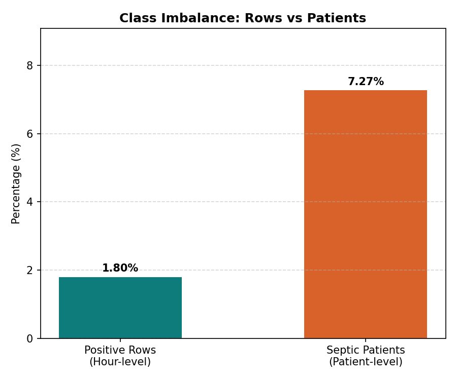

**Figure 1.** Septic patients and positive hours by hospital.

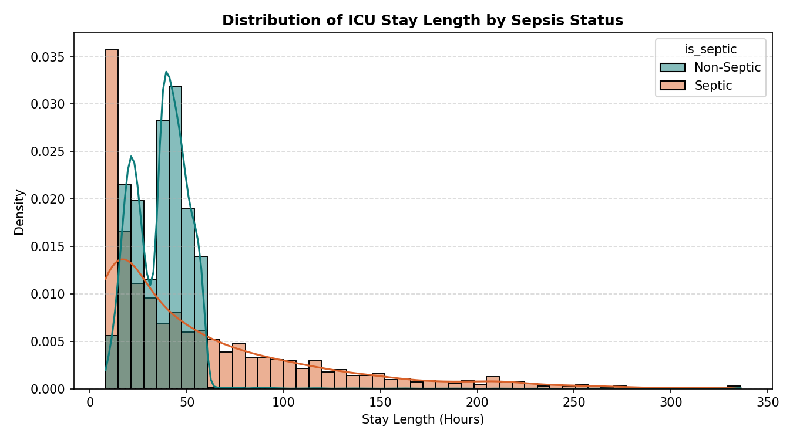

**Figure 2.** ICU length of stay distribution.

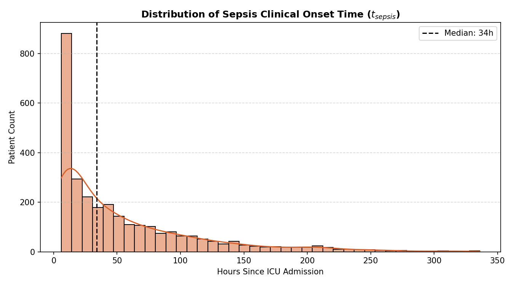

**Figure 3.** Timing of sepsis onset within the ICU stay.

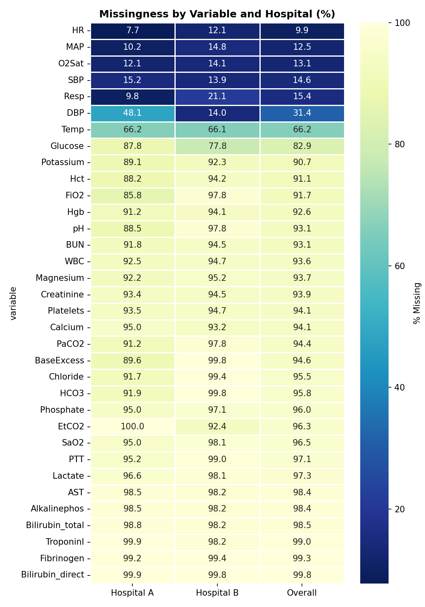

**Figure 4.** Missingness by variable and hospital.

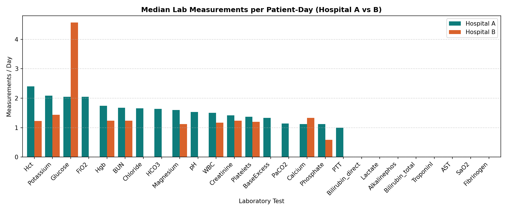

**Figure 5.** Measurement frequency by variable.

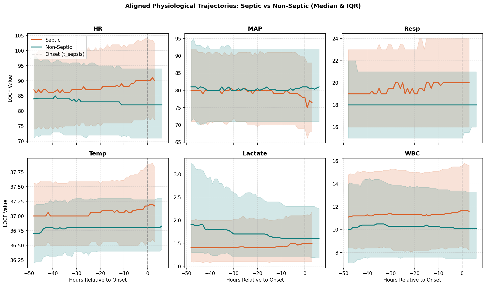

**Figure 6.** Vital-sign trajectories aligned on onset.

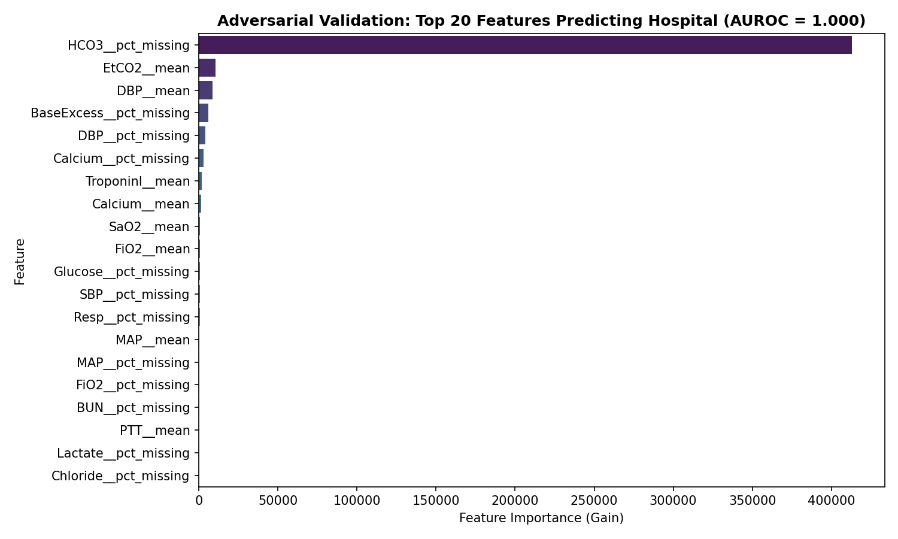

**Figure 7.** Top-20 features separating hospital A from B.

## 2. Development (5-fold out-of-fold on the dev split)

All fitting, tuning, calibration and policy choice used the 32,268 dev patients only.

**Table 6.** Baselines B0–B3, dev out-of-fold. *Source: `tables/baselines_dev_oof.csv`*

| utility_norm | auroc | auprc | brier | ece | patient_sensitivity | median_lead_time_h | false_alerts_per_patient_day | event_ppv | alert_hour_rate | baseline | best_threshold | best_k | best_sticky |
|---|---|---|---|---|---|---|---|---|---|---|---|---|---|
| 0.0000 | 0.5000 | 0.0180 | 0.0180 | 0.0180 | 0.0000 | — | 0.0000 | 0.0000 | 0.0000 | B0_never_alert | — | — | — |
| 0.0519 | 0.6133 | 0.0249 | 0.3026 | 0.3026 | 0.8303 | 25.0000 | 1.5097 | 0.0309 | 0.3036 | B1_sirs | — | — | — |
| 0.0153 | 0.5178 | 0.0192 | 0.0508 | 0.0508 | 0.2783 | 17.0000 | 0.4484 | 0.0450 | 0.0354 | B2_qsofa | — | — | — |
| 0.2528 | 0.7431 | 0.0582 | 0.2002 | 0.3944 | 0.6603 | 22.0000 | 0.2443 | 0.0722 | 0.1648 | B3_logreg | 0.7200 | 1.0000 | 6.0000 |

**Table 7.** LightGBM default vs Optuna-tuned, dev out-of-fold. *Source: `tables/lgbm_dev_oof.csv`*

| model | utility_norm | auroc | auprc | brier | ece | patient_sensitivity | median_lead_time_h | false_alerts_per_patient_day | event_ppv | alert_hour_rate | threshold | k | sticky |
|---|---|---|---|---|---|---|---|---|---|---|---|---|---|
| lgbm_default | 0.4183 | 0.8446 | 0.1221 | 0.0217 | 0.0412 | 0.8355 | 24.0000 | 0.4405 | 0.0599 | 0.1543 | 0.1000 | 1 | 0 |
| lgbm_tuned | 0.4262 | 0.8447 | 0.1223 | 0.0177 | 0.0182 | 0.8610 | 24.0000 | 0.4777 | 0.0548 | 0.1751 | 0.0500 | 1 | 0 |

**Table 8.** Optuna trials (top 10 of 40 by validation AUPRC). Showing 10 of 40 rows. *Source: `tables/optuna_trials.csv`*

| number | value | duration | params_bagging_fraction | params_feature_fraction | params_lambda_l2 | params_learning_rate | params_min_child_samples | params_num_leaves | params_scale_pos_weight | state |
|---|---|---|---|---|---|---|---|---|---|---|
| 13 | 0.1342 | 0 days 00:06:41.528331 | 0.5168 | 0.8971 | 0.3011 | 0.0102 | 847 | 126 | 2.7925 | COMPLETE |
| 10 | 0.1335 | 0 days 00:04:44.929423 | 0.6016 | 0.9223 | 0.0900 | 0.0105 | 887 | 115 | 2.2195 | COMPLETE |
| 27 | 0.1333 | 0 days 00:03:30.676442 | 0.6826 | 0.9991 | 6.7507 | 0.0215 | 760 | 75 | 3.2972 | COMPLETE |
| 33 | 0.1328 | 0 days 00:03:35.147015 | 0.5785 | 0.8864 | 1.2945 | 0.0113 | 350 | 59 | 2.4440 | COMPLETE |
| 32 | 0.1327 | 0 days 00:04:41.572605 | 0.5824 | 0.9520 | 0.9454 | 0.0118 | 395 | 75 | 3.6132 | COMPLETE |
| 26 | 0.1323 | 0 days 00:04:09.454873 | 0.5459 | 0.9599 | 0.1904 | 0.0125 | 764 | 75 | 3.3549 | COMPLETE |
| 23 | 0.1323 | 0 days 00:04:11.505736 | 0.5423 | 0.9267 | 0.2551 | 0.0126 | 435 | 102 | 1.0354 | COMPLETE |
| 22 | 0.1323 | 0 days 00:02:51.590393 | 0.5488 | 0.9232 | 0.3038 | 0.0133 | 457 | 47 | 1.1115 | COMPLETE |
| 31 | 0.1316 | 0 days 00:03:48.944179 | 0.6266 | 0.9607 | 0.1655 | 0.0151 | 775 | 74 | 2.9842 | COMPLETE |
| 35 | 0.1316 | 0 days 00:02:46.913206 | 0.6742 | 0.8903 | 8.7589 | 0.0145 | 271 | 44 | 2.5107 | COMPLETE |

**Table 9.** Feature-group ablations (tuned params, dev out-of-fold). *Source: `tables/ablations.csv`*

| variant | description | n_features | utility_norm | auroc | auprc |
|---|---|---|---|---|---|
| full | Full feature set | 298 | 0.4262 | 0.8447 | 0.1223 |
| no_missingness | Remove F2+F3+F4 (missingness signals) | 204 | 0.4039 | 0.8340 | 0.1173 |
| no_rolling | Remove F5 (rolling stats) | 160 | 0.4205 | 0.8445 | 0.1186 |
| no_deltas | Remove F6+F7 (diffs + baseline deltas) | 280 | 0.4231 | 0.8458 | 0.1257 |
| no_indices_scores | Remove F8+F9 (indices + scores) | 288 | 0.4234 | 0.8454 | 0.1207 |

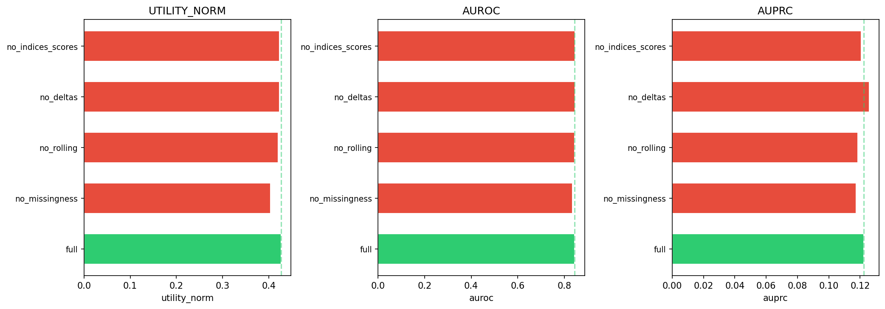

**Figure 8.** Utility by ablation variant.

## 3. Calibration and alert policy

Isotonic regression and the alert-policy grid were fitted on calibrated dev OOF scores.

**Table 10.** Alert-policy grid on calibrated dev OOF (top 10 of all configurations). Showing 10 of 594 rows. *Source: `tables/policy_grid.csv`*

| threshold | k | sticky | utility_norm |
|---|---|---|---|
| 0.0300 | 1 | 0 | 0.4267 |
| 0.0300 | 2 | 0 | 0.4178 |
| 0.0200 | 2 | 0 | 0.4160 |
| 0.0400 | 1 | 6 | 0.4138 |
| 0.0200 | 3 | 0 | 0.4115 |
| 0.0200 | 1 | 0 | 0.4110 |
| 0.0400 | 1 | 0 | 0.4052 |
| 0.0300 | 3 | 0 | 0.4038 |
| 0.0500 | 1 | 6 | 0.3989 |
| 0.0300 | 2 | 6 | 0.3987 |

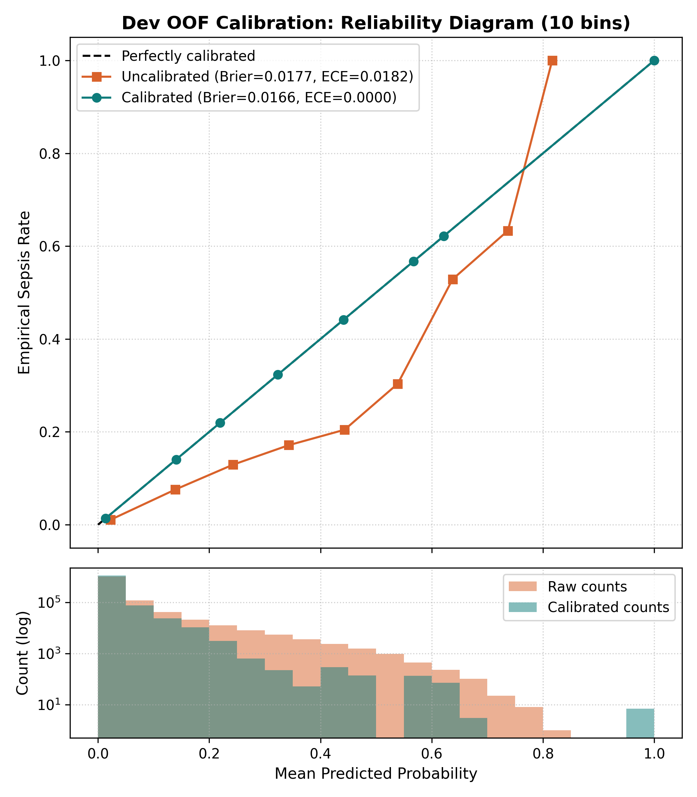

**Figure 9.** Reliability diagram on dev OOF, before/after.

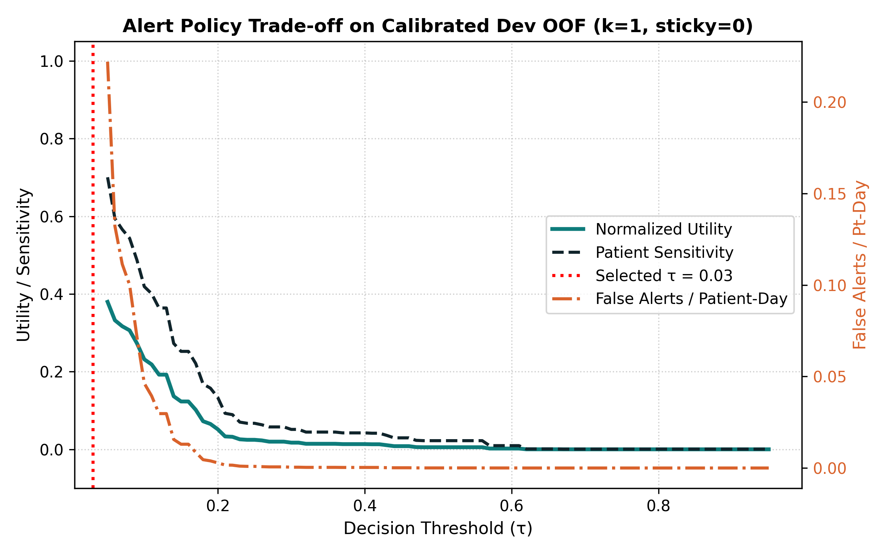

**Figure 10.** Utility, sensitivity and false alerts vs threshold.

## 4. Lockbox test (8,068 patients, evaluated once)

95% CIs from 1,000 bootstrap resamples of patients (seed 42).

**Table 11.** Final model on the lockbox test set. *Source: `tables/final_test_metrics.csv`*

| metric | value | ci_lower | ci_upper |
|---|---|---|---|
| utility_norm | 0.4270 | 0.3929 | 0.4604 |
| auroc | 0.8475 | 0.7965 | 0.8990 |
| auprc | 0.1369 | 0.0854 | 0.2311 |
| brier | 0.0164 | 0.0123 | 0.0208 |
| ece | 0.0027 | 0.0013 | 0.0084 |
| patient_sensitivity | 0.8754 | 0.8481 | 0.9013 |
| median_lead_time_h | 29.0000 | 23.0000 | 33.0000 |
| false_alerts_per_patient_day | 0.5290 | 0.5123 | 0.5469 |
| event_ppv | 0.0462 | — | — |
| alert_hour_rate | 0.2020 | — | — |

**Table 12.** Baselines on the lockbox test set. *Source: `tables/final_test_baselines.csv`*

| utility_norm | auroc | auprc | brier | ece | patient_sensitivity | median_lead_time_h | false_alerts_per_patient_day | event_ppv | alert_hour_rate | baseline |
|---|---|---|---|---|---|---|---|---|---|---|
| 0.0000 | 0.5000 | 0.0179 | 0.0179 | 0.0179 | 0.0000 | — | 0.0000 | 0.0000 | 0.0000 | B0_never_alert |
| 0.0507 | 0.6147 | 0.0249 | 0.3076 | 0.3076 | 0.8276 | 27.0000 | 1.5343 | 0.0306 | 0.3089 | B1_sirs_rule |
| 0.0122 | 0.5158 | 0.0190 | 0.0515 | 0.0515 | 0.2594 | 20.0000 | 0.4455 | 0.0428 | 0.0359 | B2_qsofa_rule |
| 0.2438 | 0.7367 | 0.0556 | 0.2036 | 0.3983 | 0.6706 | 24.0000 | 0.2491 | 0.0713 | 0.1682 | B3_logistic_regression |

**Table 13.** Final model by subgroup on the lockbox test set. *Source: `tables/final_test_subgroups.csv`*

| utility_norm | auroc | auprc | brier | ece | patient_sensitivity | median_lead_time_h | false_alerts_per_patient_day | event_ppv | alert_hour_rate | subgroup_type | subgroup_value |
|---|---|---|---|---|---|---|---|---|---|---|---|
| 0.4376 | 0.8273 | 0.1285 | 0.0198 | 0.0025 | 0.8771 | 31.0000 | 0.6588 | 0.0407 | 0.2459 | hospital | A |
| 0.4099 | 0.8665 | 0.1522 | 0.0130 | 0.0032 | 0.8728 | 21.0000 | 0.3991 | 0.0554 | 0.1561 | hospital | B |
| 0.3798 | 0.8374 | 0.1244 | 0.0147 | 0.0034 | 0.8552 | 26.0000 | 0.5329 | 0.0425 | 0.1906 | gender | 0.0 |
| 0.4554 | 0.8530 | 0.1452 | 0.0177 | 0.0023 | 0.8877 | 31.0000 | 0.5260 | 0.0489 | 0.2105 | gender | 1.0 |
| 0.3689 | 0.8256 | 0.1005 | 0.0166 | 0.0043 | 0.8864 | 33.5000 | 0.5744 | 0.0419 | 0.2222 | age_band | <45 |
| 0.4246 | 0.8512 | 0.1367 | 0.0163 | 0.0031 | 0.8804 | 25.5000 | 0.5119 | 0.0494 | 0.2025 | age_band | 45-64 |
| 0.4830 | 0.8703 | 0.1683 | 0.0165 | 0.0027 | 0.8942 | 31.0000 | 0.5102 | 0.0443 | 0.1963 | age_band | 65-79 |
| 0.3514 | 0.7993 | 0.1202 | 0.0166 | 0.0013 | 0.8025 | 29.0000 | 0.5693 | 0.0482 | 0.1927 | age_band | >=80 |

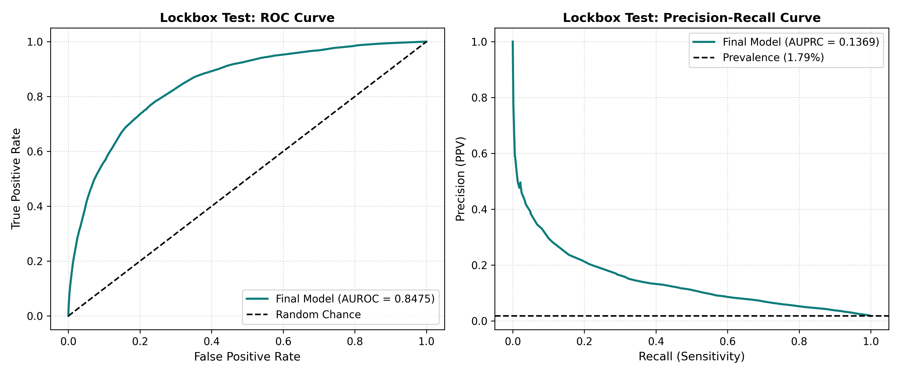

**Figure 11.** ROC and precision–recall curves (test).

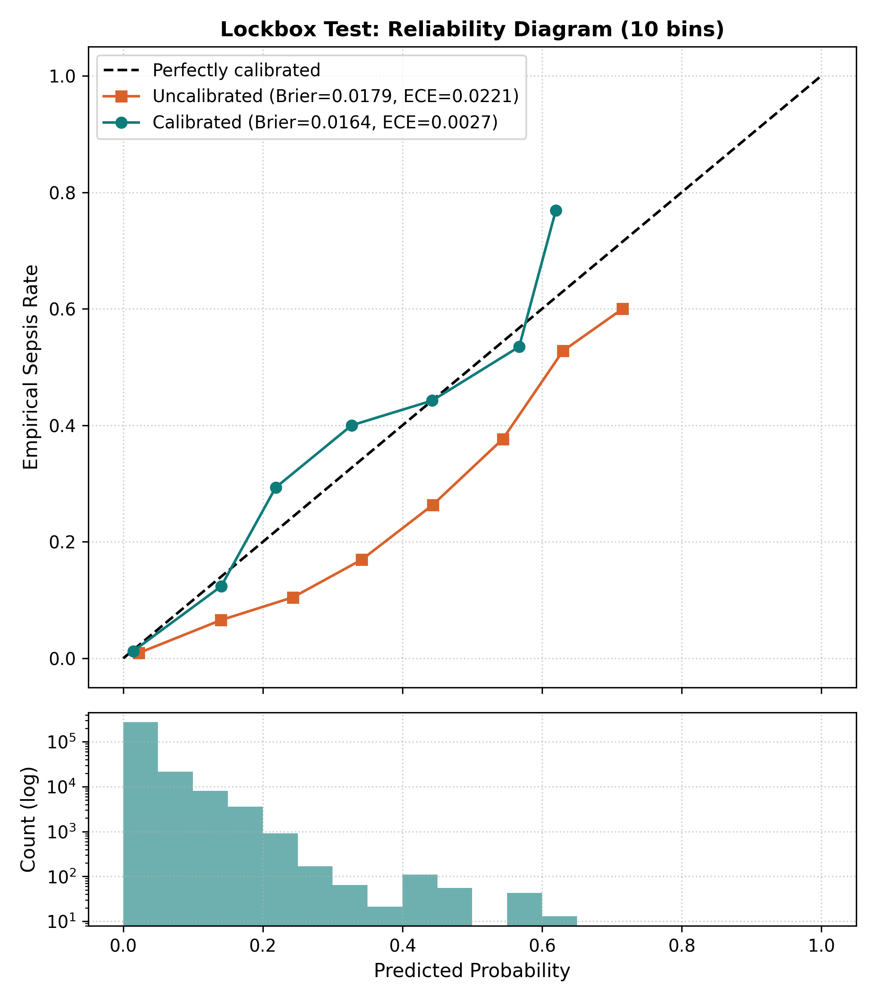

**Figure 12.** Reliability diagram (test).

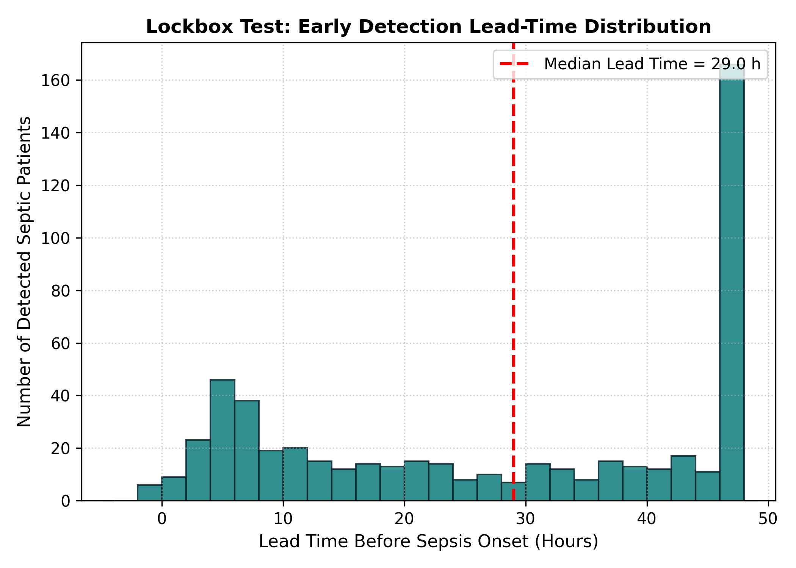

**Figure 13.** Lead time of first alert before onset (test).

## 5. Cross-hospital generalization

R0 full features; R1 no missingness; R2 per-hospital standardization; R3 no admin timing.

**Table 14.** Internal CV vs zero-shot transfer between hospitals. *Source: `tables/cross_hospital.csv`*

| variant | direction | utility_norm | auroc | auprc | patient_sensitivity | false_alerts_per_patient_day | median_lead_time_h |
|---|---|---|---|---|---|---|---|
| R0 | A internal | 0.4405 | 0.8296 | 0.1224 | 0.8469 | 0.5375 | 27.0000 |
| R0 | B internal | 0.3759 | 0.8567 | 0.1220 | 0.7662 | 0.3319 | 20.0000 |
| R0 | A->B | 0.2963 | 0.8018 | 0.0735 | 0.6629 | 0.2897 | 24.0000 |
| R0 | B->A | 0.3188 | 0.7767 | 0.0871 | 0.9156 | 0.9274 | 29.0000 |
| R1 | A internal | 0.4231 | 0.8183 | 0.1140 | 0.8123 | 0.4903 | 27.0000 |
| R1 | B internal | 0.3940 | 0.8558 | 0.1088 | 0.8240 | 0.3690 | 20.0000 |
| R1 | A->B | 0.2931 | 0.8018 | 0.0787 | 0.7049 | 0.3767 | 26.5000 |
| R1 | B->A | 0.3146 | 0.7743 | 0.0876 | 0.8860 | 0.8611 | 29.0000 |
| R2 | A internal | 0.4349 | 0.8265 | 0.1224 | 0.8503 | 0.5568 | 27.0000 |
| R2 | B internal | 0.3546 | 0.8506 | 0.1224 | 0.7364 | 0.3451 | 20.0000 |
| R2 | A->B | 0.2882 | 0.7971 | 0.0725 | 0.6848 | 0.3578 | 26.0000 |
| R2 | B->A | 0.3224 | 0.7746 | 0.0842 | 0.9145 | 0.9151 | 29.0000 |
| R3 | A internal | 0.3821 | 0.8023 | 0.0930 | 0.8559 | 0.6367 | 27.0000 |
| R3 | B internal | 0.3737 | 0.8455 | 0.1058 | 0.8284 | 0.3975 | 18.0000 |
| R3 | A->B | 0.2502 | 0.7863 | 0.0597 | 0.6944 | 0.3807 | 18.0000 |
| R3 | B->A | 0.2903 | 0.7531 | 0.0641 | 0.8525 | 0.7755 | 27.0000 |

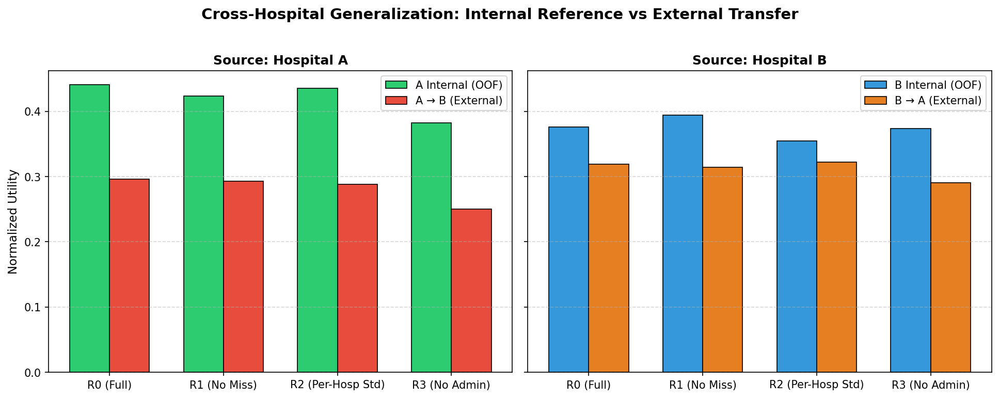

**Figure 14.** Internal vs external utility by variant.

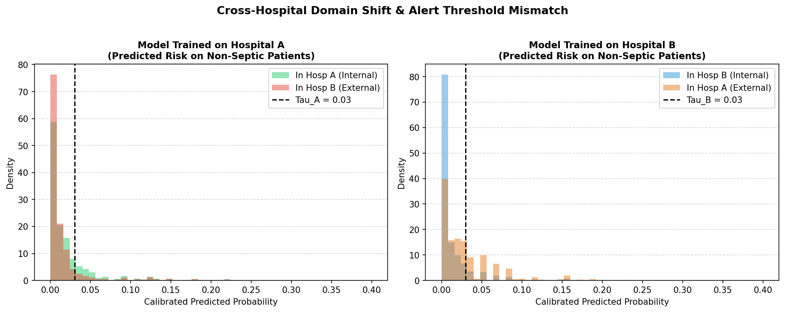

**Figure 15.** Risk score distributions, A vs B.

## 6. Explainability and subgroups (dev)

SHAP TreeExplainer on the final model; subgroup metrics on calibrated dev OOF.

**Table 15.** Global mean |SHAP| (top 20). Showing 20 of 298 rows. *Source: `tables/shap_global.csv`*

| feature | mean_abs_shap |
|---|---|
| static__iculos | 0.5465 |
| FiO2__tsl | 0.2899 |
| static__hosp_adm_time | 0.1338 |
| static__unit | 0.0718 |
| Lactate__tsl | 0.0574 |
| Temp | 0.0553 |
| Temp__max_12h | 0.0477 |
| BUN | 0.0475 |
| WBC | 0.0474 |
| idx__shock_index | 0.0453 |
| Creatinine | 0.0445 |
| score__sirs | 0.0443 |
| PaCO2__tsl | 0.0412 |
| Alkalinephos | 0.0408 |
| idx__mod_shock_index | 0.0398 |
| EtCO2__tsl | 0.0381 |
| Temp__max_6h | 0.0374 |
| Resp__min_24h | 0.0368 |
| PTT | 0.0310 |
| Resp__mean_24h | 0.0291 |

**Table 16.** Pairwise Jaccard of top-10 SHAP features across folds. *Source: `tables/shap_stability.csv`*

| fold_1 | fold_2 | jaccard |
|---|---|---|
| 0 | 1 | 0.4286 |
| 0 | 2 | 0.8182 |
| 0 | 3 | 0.5385 |
| 0 | 4 | 0.5385 |
| 1 | 2 | 0.5385 |
| 1 | 3 | 0.5385 |
| 1 | 4 | 0.5385 |
| 2 | 3 | 0.6667 |
| 2 | 4 | 0.6667 |
| 3 | 4 | 0.6667 |

**Table 17.** Subgroup metrics on calibrated dev OOF. *Source: `tables/subgroups_dev.csv`*

| utility_norm | auroc | auprc | brier | ece | patient_sensitivity | median_lead_time_h | false_alerts_per_patient_day | event_ppv | alert_hour_rate | subgroup_type | subgroup_value |
|---|---|---|---|---|---|---|---|---|---|---|---|
| 0.4301 | 0.8237 | 0.1145 | 0.0201 | 0.0003 | 0.8743 | 26.0000 | 0.6208 | 0.0507 | 0.2254 | hospital | A |
| 0.4214 | 0.8631 | 0.1297 | 0.0130 | 0.0004 | 0.8534 | 19.0000 | 0.3559 | 0.0603 | 0.1290 | hospital | B |
| 0.4234 | 0.8504 | 0.1174 | 0.0155 | 0.0011 | 0.8652 | 25.0000 | 0.4792 | 0.0504 | 0.1715 | gender | 0.0 |
| 0.4291 | 0.8409 | 0.1221 | 0.0175 | 0.0009 | 0.8668 | 23.0000 | 0.4937 | 0.0573 | 0.1833 | gender | 1.0 |
| 0.4760 | 0.8618 | 0.1241 | 0.0171 | 0.0005 | 0.9155 | 22.0000 | 0.5192 | 0.0574 | 0.1864 | age_band | <45 |
| 0.4205 | 0.8429 | 0.1200 | 0.0164 | 0.0002 | 0.8560 | 25.0000 | 0.4679 | 0.0541 | 0.1722 | age_band | 45-64 |
| 0.4188 | 0.8375 | 0.1186 | 0.0169 | 0.0005 | 0.8490 | 25.0000 | 0.4744 | 0.0522 | 0.1807 | age_band | 65-79 |
| 0.4065 | 0.8520 | 0.1219 | 0.0160 | 0.0015 | 0.8816 | 23.0000 | 0.5364 | 0.0562 | 0.1778 | age_band | >=80 |

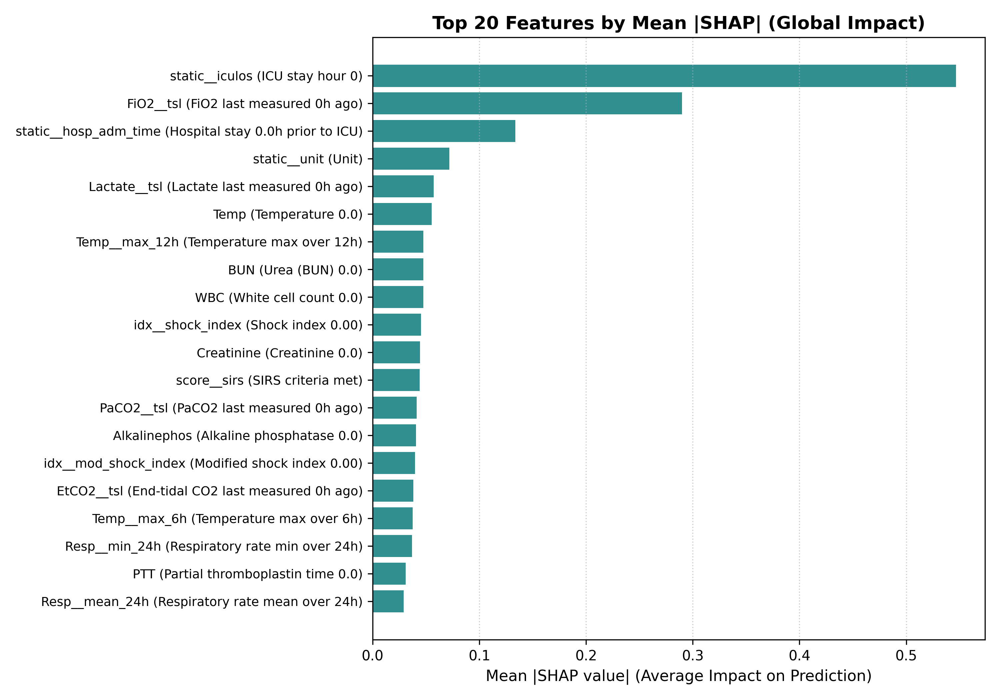

**Figure 16.** Top-20 features by mean |SHAP|.

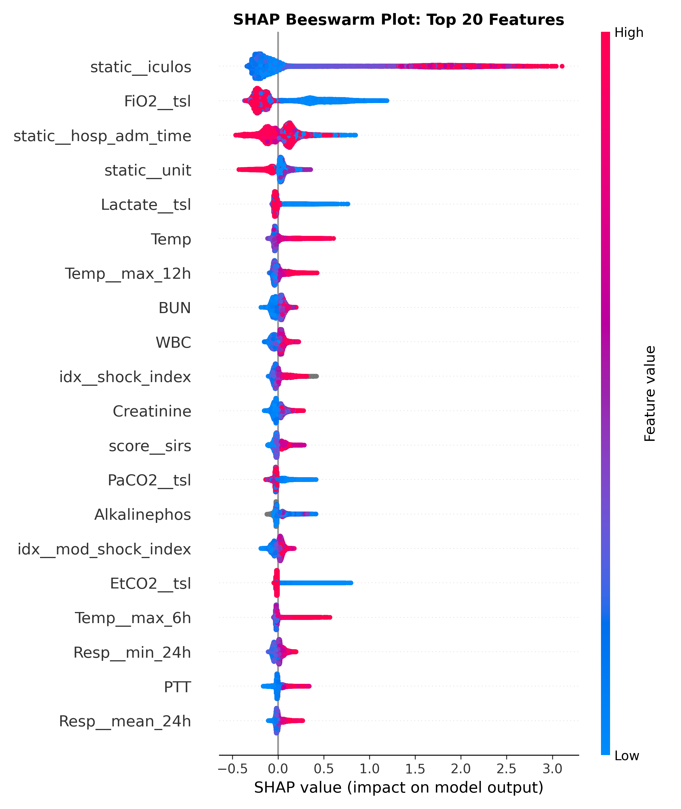

**Figure 17.** SHAP beeswarm, top-20 features.

## Appendix: other artifacts

**Table 18.** ensemble_dev_bootstrap. *Source: `tables/ensemble_dev_bootstrap.csv`*

| comparison | diff | ci_low | ci_high | prob_better |
|---|---|---|---|---|
| gru/plain - lgbm/- | -0.0698 | -0.0838 | -0.0563 | 0.0000 |
| ensemble/plain - lgbm/- | 0.0058 | 0.0011 | 0.0106 | 0.9930 |
| ensemble/h64 - lgbm/- | 0.0131 | 0.0072 | 0.0190 | 1.0000 |
| ensemble/h64 - ensemble/plain | 0.0072 | 0.0033 | 0.0109 | 1.0000 |
| ensemble/top32 - lgbm/- | 0.0056 | 0.0017 | 0.0096 | 0.9980 |
| ensemble/top32 - ensemble/plain | -0.0002 | -0.0039 | 0.0032 | 0.4540 |

**Table 19.** ensemble_dev_comparison. *Source: `tables/ensemble_dev_comparison.csv`*

| model | gru_variant | scheme | utility_norm | auroc | auprc | ece | patient_sensitivity | median_lead_time_h | false_alerts_per_patient_day | threshold | k | sticky | weight |
|---|---|---|---|---|---|---|---|---|---|---|---|---|---|
| lgbm | - | pooled | 0.4267 | 0.8451 | 0.1198 | 3.57e-18 | 0.8662 | 24.0000 | 0.4872 | 0.0300 | 1 | 0 | — |
| lgbm | - | nested | 0.4196 | 0.8421 | 0.1179 | 0.0002 | 0.8546 | 23.0000 | 0.4777 | 0.0300 | 1 | 0 | — |
| gru | plain | pooled | 0.3633 | 0.8151 | 0.1097 | 7.81e-20 | 0.8146 | 23.0000 | 0.4526 | 0.0300 | 1 | 0 | — |
| gru | plain | nested | 0.3498 | 0.8069 | 0.1040 | 0.0008 | 0.8039 | 23.0000 | 0.4549 | 0.0300 | 1 | 0 | — |
| ensemble | plain | pooled | 0.4319 | 0.8474 | 0.1314 | 0.0008 | 0.8495 | 23.0000 | 0.4128 | 0.0300 | 1 | 0 | 0.7000 |
| ensemble | plain | nested | 0.4255 | 0.8438 | 0.1244 | 0.0006 | 0.8500 | 23.0000 | 0.4295 | 0.0300 | 1 | 0 | 0.7000 |
| gru | h64 | pooled | 0.3690 | 0.8188 | 0.1081 | 8.46e-18 | 0.8039 | 23.0000 | 0.4154 | 0.0300 | 1 | 0 | — |
| gru | h64 | nested | 0.3529 | 0.8119 | 0.1053 | 0.0005 | 0.7813 | 22.0000 | 0.3997 | 0.0300 | 1 | 0 | — |
| ensemble | h64 | pooled | 0.4362 | 0.8488 | 0.1308 | 0.0009 | 0.8500 | 23.0000 | 0.4093 | 0.0300 | 1 | 0 | 0.7000 |
| ensemble | h64 | nested | 0.4327 | 0.8466 | 0.1264 | 0.0008 | 0.8500 | 23.0000 | 0.4146 | 0.0300 | 1 | 0 | 0.7000 |
| gru | top32 | pooled | 0.3605 | 0.8185 | 0.1110 | 7.25e-20 | 0.7903 | 23.0000 | 0.4190 | 0.0300 | 1 | 0 | — |
| gru | top32 | nested | 0.3422 | 0.8110 | 0.1072 | 0.0006 | 0.7873 | 24.0000 | 0.4417 | 0.0300 | 1 | 0 | — |
| ensemble | top32 | pooled | 0.4302 | 0.8486 | 0.1311 | 0.0008 | 0.8465 | 23.0000 | 0.4126 | 0.0300 | 1 | 0 | 0.7000 |
| ensemble | top32 | nested | 0.4252 | 0.8457 | 0.1238 | 0.0004 | 0.8512 | 23.0000 | 0.4410 | 0.0300 | 1 | 0 | 0.7000 |

**Table 20.** ensemble_dev_final. *Source: `tables/ensemble_dev_final.csv`*

| model | gru_variant | scheme | utility_norm | auroc | auprc | ece | patient_sensitivity | median_lead_time_h | false_alerts_per_patient_day | weight_lgbm | threshold | k | sticky | gru_epochs |
|---|---|---|---|---|---|---|---|---|---|---|---|---|---|---|
| ensemble | h64 | nested | 0.4327 | 0.8466 | 0.1264 | 0.0008 | 0.8500 | 23.0000 | 0.4146 | 0.7000 | 0.0300 | 1 | 0 | 5 |
| ensemble | h64 | pooled | 0.4362 | 0.8488 | 0.1308 | 0.0009 | 0.8500 | 23.0000 | 0.4093 | 0.7000 | 0.0300 | 1 | 0 | 5 |

**Table 21.** ensemble_dev_fold_params. Showing 20 of 35 rows. *Source: `tables/ensemble_dev_fold_params.csv`*

| model | gru_variant | fold | threshold | k | sticky | utility_norm | weight |
|---|---|---|---|---|---|---|---|
| lgbm | - | 0 | 0.0300 | 1 | 0 | 0.4263 | — |
| lgbm | - | 1 | 0.0300 | 1 | 0 | 0.4296 | — |
| lgbm | - | 2 | 0.0300 | 1 | 0 | 0.4245 | — |
| lgbm | - | 3 | 0.0300 | 1 | 0 | 0.4253 | — |
| lgbm | - | 4 | 0.0300 | 1 | 0 | 0.4296 | — |
| gru | plain | 0 | 0.0300 | 1 | 0 | 0.3808 | — |
| gru | plain | 1 | 0.0300 | 1 | 0 | 0.3541 | — |
| gru | plain | 2 | 0.0300 | 1 | 0 | 0.3711 | — |
| gru | plain | 3 | 0.0300 | 1 | 0 | 0.3642 | — |
| gru | plain | 4 | 0.0300 | 1 | 0 | 0.3557 | — |
| ensemble | plain | 0 | 0.0300 | 1 | 0 | 0.4336 | 0.7000 |
| ensemble | plain | 1 | 0.0300 | 1 | 0 | 0.4331 | 0.8000 |
| ensemble | plain | 2 | 0.0300 | 1 | 0 | 0.4296 | 0.7000 |
| ensemble | plain | 3 | 0.0300 | 1 | 0 | 0.4302 | 0.8000 |
| ensemble | plain | 4 | 0.0300 | 1 | 0 | 0.4344 | 0.8000 |
| gru | h64 | 0 | 0.0300 | 1 | 0 | 0.3713 | — |
| gru | h64 | 1 | 0.0300 | 1 | 0 | 0.3665 | — |
| gru | h64 | 2 | 0.0300 | 1 | 0 | 0.3820 | — |
| gru | h64 | 3 | 0.0300 | 1 | 0 | 0.3662 | — |
| gru | h64 | 4 | 0.0300 | 1 | 0 | 0.3660 | — |

**Table 22.** ensemble_dev_weights. *Source: `tables/ensemble_dev_weights.csv`*

| gru_variant | weight_lgbm | nested_utility_norm | nested_auroc | nested_auprc | nested_ece | nested_patient_sensitivity | nested_median_lead_time_h | nested_false_alerts_per_patient_day | nested_policy_threshold | pooled_utility_norm | folds_selecting | pooled_selects |
|---|---|---|---|---|---|---|---|---|---|---|---|---|
| plain | 0.5000 | 0.4159 | 0.8408 | 0.1254 | 0.0010 | 0.8427 | 23.0000 | 0.4128 | 0.03,0.03,0.03,0.03,0.03 | 0.4228 | 0 | False |
| plain | 0.6000 | 0.4239 | 0.8431 | 0.1265 | 0.0010 | 0.8500 | 22.0000 | 0.4111 | 0.03,0.03,0.03,0.03,0.03 | 0.4290 | 0 | False |
| plain | 0.7000 | 0.4264 | 0.8444 | 0.1262 | 0.0008 | 0.8491 | 23.0000 | 0.4203 | 0.03,0.03,0.03,0.03,0.03 | 0.4319 | 2 | True |
| plain | 0.8000 | 0.4280 | 0.8449 | 0.1247 | 0.0005 | 0.8529 | 23.0000 | 0.4338 | 0.03,0.03,0.03,0.03,0.03 | 0.4318 | 3 | False |
| plain | 0.9000 | 0.4265 | 0.8443 | 0.1224 | 0.0003 | 0.8585 | 23.0000 | 0.4544 | 0.03,0.03,0.03,0.03,0.03 | 0.4302 | 0 | False |
| h64 | 0.5000 | 0.4246 | 0.8438 | 0.1264 | 0.0010 | 0.8470 | 23.0000 | 0.4024 | 0.03,0.03,0.03,0.03,0.03 | 0.4293 | 0 | False |
| h64 | 0.6000 | 0.4310 | 0.8457 | 0.1270 | 0.0009 | 0.8483 | 23.0000 | 0.4034 | 0.03,0.03,0.03,0.03,0.03 | 0.4346 | 0 | False |
| h64 | 0.7000 | 0.4327 | 0.8466 | 0.1264 | 0.0008 | 0.8500 | 23.0000 | 0.4146 | 0.03,0.03,0.03,0.03,0.03 | 0.4362 | 5 | True |
| h64 | 0.8000 | 0.4323 | 0.8465 | 0.1247 | 0.0006 | 0.8542 | 23.0000 | 0.4282 | 0.03,0.03,0.03,0.03,0.03 | 0.4351 | 0 | False |
| h64 | 0.9000 | 0.4287 | 0.8451 | 0.1223 | 0.0003 | 0.8585 | 23.0000 | 0.4542 | 0.03,0.03,0.03,0.03,0.03 | 0.4318 | 0 | False |
| top32 | 0.5000 | 0.4176 | 0.8433 | 0.1265 | 0.0009 | 0.8410 | 23.0000 | 0.4132 | 0.03,0.03,0.03,0.03,0.03 | 0.4232 | 0 | False |
| top32 | 0.6000 | 0.4228 | 0.8453 | 0.1270 | 0.0009 | 0.8470 | 23.0000 | 0.4158 | 0.03,0.03,0.03,0.03,0.03 | 0.4277 | 0 | False |
| top32 | 0.7000 | 0.4261 | 0.8464 | 0.1264 | 0.0008 | 0.8470 | 23.0000 | 0.4204 | 0.03,0.03,0.03,0.03,0.03 | 0.4302 | 0 | True |
| top32 | 0.8000 | 0.4255 | 0.8464 | 0.1247 | 0.0005 | 0.8491 | 23.0000 | 0.4359 | 0.03,0.03,0.03,0.03,0.03 | 0.4298 | 4 | False |
| top32 | 0.9000 | 0.4253 | 0.8452 | 0.1222 | 0.0003 | 0.8542 | 23.0000 | 0.4548 | 0.03,0.03,0.03,0.03,0.03 | 0.4299 | 1 | False |

**Table 23.** gru_dev_comparison. *Source: `tables/gru_dev_comparison.csv`*

| model | scheme | utility_norm | auroc | auprc | ece | patient_sensitivity | median_lead_time_h | false_alerts_per_patient_day | threshold | k | sticky | weight |
|---|---|---|---|---|---|---|---|---|---|---|---|---|
| lgbm | pooled | 0.4267 | 0.8451 | 0.1198 | 3.57e-18 | 0.8662 | 24.0000 | 0.4872 | 0.0300 | 1 | 0 | — |
| lgbm | nested | 0.4196 | 0.8421 | 0.1179 | 0.0002 | 0.8546 | 23.0000 | 0.4777 | 0.0300 | 1 | 0 | — |
| gru | pooled | 0.3633 | 0.8151 | 0.1097 | 7.81e-20 | 0.8146 | 23.0000 | 0.4526 | 0.0300 | 1 | 0 | — |
| gru | nested | 0.3498 | 0.8069 | 0.1040 | 0.0008 | 0.8039 | 23.0000 | 0.4549 | 0.0300 | 1 | 0 | — |
| ensemble | pooled | 0.4319 | 0.8474 | 0.1314 | 0.0008 | 0.8495 | 23.0000 | 0.4128 | 0.0300 | 1 | 0 | 0.7000 |
| ensemble | nested | 0.4264 | 0.8444 | 0.1262 | 0.0008 | 0.8491 | 23.0000 | 0.4203 | 0.0300 | 1 | 0 | 0.7000 |

**Table 24.** gru_dev_comparison_bootstrap. *Source: `tables/gru_dev_comparison_bootstrap.csv`*

| comparison | diff | ci_low | ci_high | prob_better |
|---|---|---|---|---|
| gru - lgbm | -0.0698 | -0.0838 | -0.0563 | 0.0000 |
| ensemble - lgbm | 0.0068 | 0.0016 | 0.0125 | 0.9950 |

**Table 25.** gru_dev_comparison_fold_params. *Source: `tables/gru_dev_comparison_fold_params.csv`*

| model | fold | threshold | k | sticky | utility_norm | weight |
|---|---|---|---|---|---|---|
| lgbm | 0 | 0.0300 | 1 | 0 | 0.4263 | — |
| lgbm | 1 | 0.0300 | 1 | 0 | 0.4296 | — |
| lgbm | 2 | 0.0300 | 1 | 0 | 0.4245 | — |
| lgbm | 3 | 0.0300 | 1 | 0 | 0.4253 | — |
| lgbm | 4 | 0.0300 | 1 | 0 | 0.4296 | — |
| gru | 0 | 0.0300 | 1 | 0 | 0.3808 | — |
| gru | 1 | 0.0300 | 1 | 0 | 0.3541 | — |
| gru | 2 | 0.0300 | 1 | 0 | 0.3711 | — |
| gru | 3 | 0.0300 | 1 | 0 | 0.3642 | — |
| gru | 4 | 0.0300 | 1 | 0 | 0.3557 | — |
| ensemble | 0 | 0.0300 | 1 | 0 | 0.4336 | 0.7000 |
| ensemble | 1 | 0.0300 | 1 | 0 | 0.4329 | 0.7000 |
| ensemble | 2 | 0.0300 | 1 | 0 | 0.4296 | 0.7000 |
| ensemble | 3 | 0.0300 | 1 | 0 | 0.4299 | 0.7000 |
| ensemble | 4 | 0.0300 | 1 | 0 | 0.4344 | 0.7000 |

**Table 26.** policy_grid_ablation_no_deltas. Showing 5 of 594 rows. *Source: `tables/policy_grid_ablation_no_deltas.csv`*

| threshold | k | sticky | utility_norm |
|---|---|---|---|
| 0.0500 | 1 | 0 | 0.4231 |
| 0.0600 | 1 | 0 | 0.4208 |
| 0.0500 | 2 | 0 | 0.4176 |
| 0.0400 | 2 | 0 | 0.4144 |
| 0.0700 | 1 | 0 | 0.4113 |

**Table 27.** policy_grid_ablation_no_indices_scores. Showing 5 of 594 rows. *Source: `tables/policy_grid_ablation_no_indices_scores.csv`*

| threshold | k | sticky | utility_norm |
|---|---|---|---|
| 0.0500 | 1 | 0 | 0.4234 |
| 0.0600 | 1 | 0 | 0.4230 |
| 0.0700 | 1 | 6 | 0.4154 |
| 0.0400 | 2 | 0 | 0.4150 |
| 0.0500 | 2 | 0 | 0.4149 |

**Table 28.** policy_grid_ablation_no_missingness. Showing 5 of 594 rows. *Source: `tables/policy_grid_ablation_no_missingness.csv`*

| threshold | k | sticky | utility_norm |
|---|---|---|---|
| 0.0500 | 1 | 0 | 0.4039 |
| 0.0600 | 1 | 0 | 0.4020 |
| 0.0500 | 2 | 0 | 0.3968 |
| 0.0400 | 2 | 0 | 0.3950 |
| 0.0400 | 1 | 0 | 0.3936 |

**Table 29.** policy_grid_ablation_no_rolling. Showing 5 of 594 rows. *Source: `tables/policy_grid_ablation_no_rolling.csv`*

| threshold | k | sticky | utility_norm |
|---|---|---|---|
| 0.0600 | 1 | 0 | 0.4205 |
| 0.0500 | 1 | 0 | 0.4186 |
| 0.0700 | 1 | 0 | 0.4138 |
| 0.0800 | 1 | 6 | 0.4121 |
| 0.0700 | 1 | 6 | 0.4119 |

**Table 30.** policy_grid_lgbm_default. Showing 5 of 594 rows. *Source: `tables/policy_grid_lgbm_default.csv`*

| threshold | k | sticky | utility_norm |
|---|---|---|---|
| 0.1000 | 1 | 0 | 0.4183 |
| 0.0900 | 1 | 0 | 0.4174 |
| 0.0800 | 1 | 0 | 0.4138 |
| 0.1300 | 1 | 6 | 0.4133 |
| 0.1200 | 1 | 6 | 0.4130 |

**Table 31.** policy_grid_lgbm_tuned. Showing 5 of 594 rows. *Source: `tables/policy_grid_lgbm_tuned.csv`*

| threshold | k | sticky | utility_norm |
|---|---|---|---|
| 0.0500 | 1 | 0 | 0.4262 |
| 0.0600 | 1 | 0 | 0.4197 |
| 0.0400 | 2 | 0 | 0.4182 |
| 0.0500 | 2 | 0 | 0.4169 |
| 0.0400 | 1 | 0 | 0.4156 |
