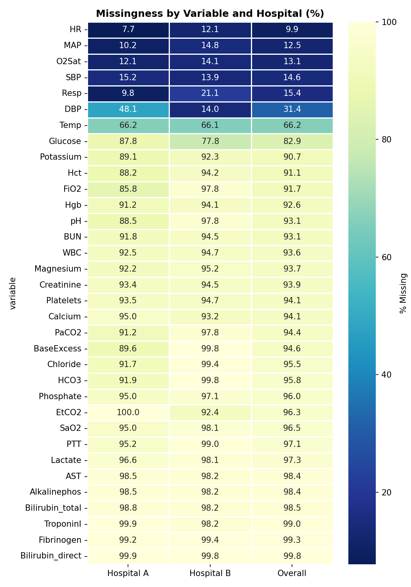
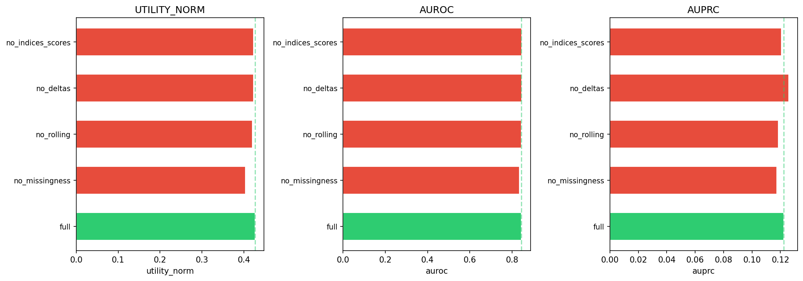
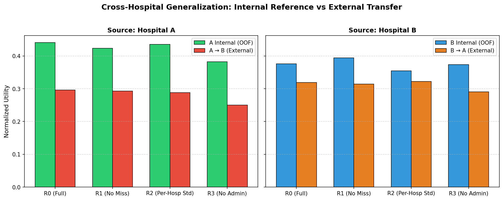
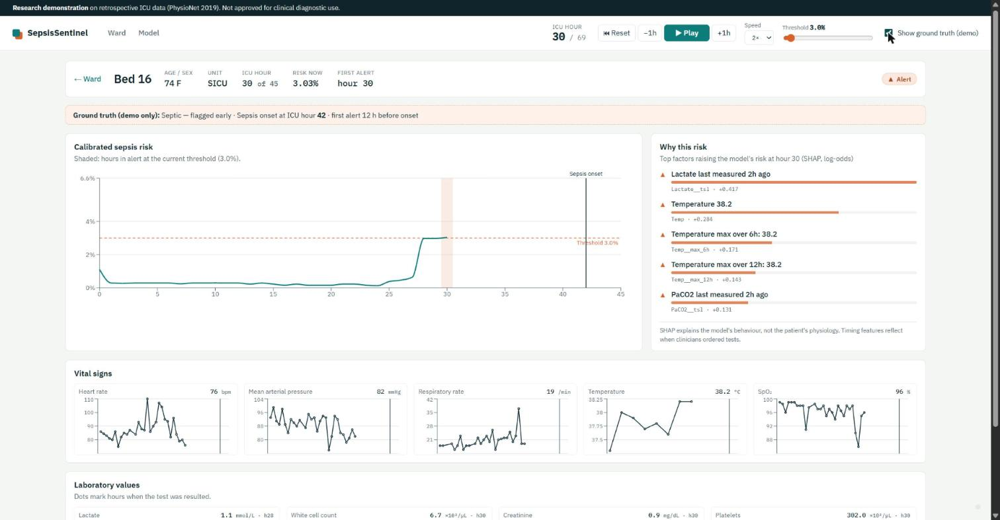

<!-- _class: lead -->
<!-- _paginate: false -->

# SepsisSentinel
## Calibrated, explainable early warning of ICU sepsis, and what happens when it changes hospitals

**Amaan Surti** · Data Science & Machine Learning · Semester 7 · October 2026

<!--
SPEAKER NOTES (20 s)
Good morning. SepsisSentinel is a real-time early-warning system for sepsis in the ICU.
I'll show what it achieves on an untouched test set, where it breaks when it moves to a new hospital,
and a live dashboard that replays real test patients.
Every number on these slides comes straight from the repo's results tables; the test set was opened once.
-->

---

## Why sepsis, why early

- Sepsis = life-threatening organ dysfunction from a dysregulated response to infection (**Sepsis-3**)
- ~**49 M cases** and **11 M deaths** worldwide in 2017 (Rudd et al., 2020)
- Each hour of delay in effective antibiotics in septic shock lowers survival (Kumar et al., 2006)
- The problem is *recognition*: early sepsis is subtle, hidden in hourly vitals and sparse labs
- But too many alerts → **alarm fatigue** → alerts ignored

<!--
LAYOUT: left text column; optional right-side icon of an ICU monitor. Keep to 5 bullets.
NOTES (45 s)
Sepsis kills about one in five people who die worldwide. Time-to-antibiotics matters hour by hour.
The clinical bottleneck is spotting it early, and an AI alert is only useful if clinicians trust it,
so we must care about false alarms as much as about catching cases.
TAKEAWAY: the goal is "early and trustworthy", not just "accurate".
-->

---

## Data: PhysioNet / CinC Challenge 2019, by the numbers

| | Hospital A | Hospital B | Total |
|---|---|---|---|
| Patients | 20,336 | 20,000 | **40,336** |
| Hourly rows | 790,215 | 761,995 | **1,552,210** |
| Septic patients | 1,790 (8.80%) | 1,142 (5.71%) | **2,932 (7.27%)** |
| Positive hours | 2.17% | 1.41% | **1.80%** |
| Median ICU stay | 39 h | 38 h | 38 h |

40 variables per hour: 8 vitals, 26 labs, 6 demographic/admin. Label = 1 from **6 h before** Sepsis-3 onset.

> Reyna et al., Crit Care Med 2020. Hidden test set and hospital C are not public.

<!--
NOTES (40 s)
Two hospitals, forty thousand stays, one and a half million hourly rows. Only 1.8% of hours are positive.
A model that never alerts is 98.2% accurate, which is why we never report accuracy.
The label switches on six hours before clinical onset, so predicting the label means anticipating onset.
-->

---

## Missing values are the norm, and they differ by hospital

- HR missing in **9.9%** of hours; temperature **66%**; most labs **> 90%**
- DBP missing **48%** at A vs **14%** at B
- An adversarial classifier tells the hospitals apart with **AUROC = 1.0000**, driven mainly by HCO3 *missingness*
- A test that gets *ordered* is a signal of clinical concern

<!--
LAYOUT: real missingness heatmap on the right half (replaces the illustrative grid from the proposal deck).
NOTES (45 s)
This is the real missingness map. Labs are mostly empty, and the patterns are hospital-specific:
a simple model can identify the hospital perfectly from what was measured.
That gives us an opportunity (missingness carries information) and a risk (the model may learn the hospital).
-->

---

## Method: a pipeline that cannot see the future

1. **Patient-level lockbox:** 8,068 test patients locked away; 32,268 dev patients in 5 folds
2. **298 causal features:** LOCF values, measured flags, hours since last test, 6/12/24-h rolling stats & slopes, baseline deltas, shock index, SIRS / partial SOFA
3. **LightGBM**, tuned with Optuna (40 trials), final model 303 rounds
4. **Isotonic calibration** on out-of-fold predictions
5. **Alert policy** chosen to maximise the official utility → *τ = 0.03, k = 1, sticky = 0*
6. **SHAP** reasons for every hour

Leakage test: features on the full stay == features on any prefix (20 random patients) ✔

<!--
LAYOUT: a horizontal pipeline diagram (boxes with arrows) works better than a list if time allows.
NOTES (60 s)
Every feature at hour t uses only hours up to t. We prove it with a test: compute features on the full stay
and on a truncated stay; the overlapping rows must be identical. Everything that is fitted (hyperparameters,
calibrator, threshold) used development patients only. The test set was opened exactly once at the end.
-->

---

## Evaluation: the Challenge utility rewards timing

- Septic patient: alert in **[t−12, t+3]** earns credit (max +1 from t−6); a missed hour near onset costs up to **−2**
- Non-septic patient: every alert hour costs **−0.05**
- Normalised: never alert = **0**, perfect = **1**
- Also reported: AUROC/AUPRC, calibration (ECE), **sensitivity**, **lead time**, **false alerts per patient-day**, event PPV
- 95% CIs: 1,000 bootstrap resamples of **patients**

<!--
LAYOUT: optional small sketch of the utility curve vs time-to-onset on the right.
NOTES (40 s)
The official score encodes the clinical trade-off: early true alerts are good, misses near onset are very bad,
and every false alarm costs a little. We also report the clinical numbers a ward manager would ask for.
-->

---

<!-- _class: lead -->

## Lockbox test: 8,068 patients, evaluated once

# 0.4270

**normalized utility** (95% CI 0.3929 – 0.4604), the same as dev out-of-fold (0.4267)

| AUROC | Sensitivity | Median lead | False alerts / patient-day | ECE |
|---|---|---|---|---|
| **0.8475** | **87.54%** | **29.0 h** | **0.53** | **0.0027** |

<!--
NOTES (50 s)
On the untouched test set: utility 0.427, within 0.0003 of the development estimate, so there is no overfitting.
Nearly 9 in 10 septic patients get an alert in the clinically useful window. The median first alert comes
29 hours before onset, and calibration error is 0.003, so a displayed 3% risk really means about 3%.
Cost: about one false alert per non-septic patient every 45 hours.
TAKEAWAY: strong, honest, reproducible.
-->

---

## Results vs baselines (same test set)

| Model | Utility | AUROC | Sensitivity | False alerts/day |
|---|---|---|---|---|
| B0 never alert | 0.0000 | 0.500 | 0.00% | 0.00 |
| B1 SIRS ≥ 2 | 0.0507 | 0.615 | 82.76% | *1.53* |
| B2 qSOFA ≥ 2 | 0.0122 | 0.516 | *25.94%* | 0.45 |
| B3 logistic regression | 0.2438 | 0.737 | 67.06% | 0.25 |
| **SepsisSentinel** | **0.4270** | **0.848** | **87.54%** | 0.53 |

**+75%** utility over logistic regression · **8.4×** SIRS · AUPRC 0.137 = **7.6×** chance (1.79%)

<!--
NOTES (50 s)
SIRS catches almost as many patients but alarms three times as often, so its utility is near zero.
qSOFA is quiet but misses three quarters. Logistic regression is the real competitor; we beat it by 75%
and catch 20 percentage points more septic patients. If asked about AUPRC 0.137: chance level is the
positive rate, 1.8%, so this is 7.6 times better than chance.
-->

---

## Ablation: missingness is a signal

| Removed (dev OOF) | Utility | Δ |
|---|---|---|
| nothing (298 features) | 0.4262 | – |
| **missingness F2–F4** | **0.4039** | *−0.0223* |
| rolling stats F5 | 0.4205 | −0.0057 |
| diffs + deltas F6–F7 | 0.4231 | −0.0030 |
| indices + scores F8–F9 | 0.4234 | −0.0028 |

<!--
NOTES (40 s)
Removing the "was it measured, and how long ago" features costs 5% of utility, by far the largest drop.
The tree model can rebuild rolling stats from raw values, but it can't rebuild ordering behaviour.
Top SHAP features agree: time in ICU, hours since FiO2 and lactate were recorded, then fever, WBC, BUN, shock index.
-->

---

<!-- _class: dense -->

## Cross-hospital finding: performance is partly local

| (R0, full features) | Utility | Sens. | FA/day |
|---|---|---|---|
| A internal | 0.4405 | 84.7% | 0.54 |
| **A → B** | *0.2963* | *66.3%* | 0.29 |
| B internal | 0.3759 | 76.6% | 0.33 |
| **B → A** | *0.3188* | 91.6% | *0.93* |

- A → B utility **−32.7%**; AUROC drops only 0.03–0.08
- Main failure = **operating point**: too few alerts (A→B), 3× false alarms (B→A)
- No missingness (R1) or per-site z-scores (R2): gap **not** closed

<!--
NOTES (60 s) THE HEADLINE FINDING
Train at one hospital, deploy at the other, and you lose up to a third of the utility.
Ranking survives; the threshold does not. A's threshold is too strict at B, so sensitivity falls to 66%;
B's threshold at A nearly triples false alarms. It's not just missingness: removing those features
leaves the gap unchanged, and z-scoring per hospital doesn't fix it either.
TAKEAWAY: never deploy without local threshold tuning and a silent trial. This matches what happened
to hospital C in the Challenge and to commercial sepsis models in the literature.
-->

---

<!-- _class: dense -->

## Product: from model to bedside demo

- **FastAPI**: model, calibrator, policy, SHAP loaded once
- **React + TypeScript** dashboard: replay clock, threshold slider, show-truth toggle
- One code path for training and online `/api/predict` (diff = 0)
- **Docker Compose**: API :8000 + UI :8080
- 67 automated tests

<!--
LAYOUT: real screenshot of a demo patient (Bed 16) on the right ("one patient's stay" slide uses this).
NOTES (40 s)
The dashboard replays 24 real test patients hour by hour. Bed 16 alerts at hour 30; turning on ground truth
shows onset at hour 42, 12 hours later. The reasons panel says lactate was drawn two hours ago and she has a fever.
The demo deliberately includes 2 missed septic patients and 4 false alarms.
-->

---

<!-- _class: lead -->

## Live demo (3 minutes)

1. Ward at hour 0 → **Play** (2×)
2. Pause when **Bed 03** turns *Alert* (hour 16), the first septic bed to alert
3. Open the patient → read **"Why this risk"**
4. Toggle **Show ground truth** → onset at hour 22, 6 h after the alert
5. Show a miss (**Bed 07**), then move the **threshold slider** → more / fewer alerts; Model page trade-off
6. Close on the disclaimer

> Fallback: 60-s screen recording in case the laptop fails.

<!--
NOTES: follow reports/demo_script.md exactly. If the backend fails, switch to the recording.
-->

---

## Limitations and ethics

- Retrospective, de-identified data from two hospitals; **no hospital C**, external validity only simulated
- Sepsis-3 labels from records are not perfect ground truth
- τ = 0.03 → 20% of hours in alert, event PPV 4.6%: sensitivity bought with alerts
- Lead time inflated by persistent early alerts; utility gives no credit before t−12
- SHAP explains the **model**, not causes; timing features reflect clinician behaviour
- Subgroups underpowered (weakest: age ≥ 80, sensitivity 80.3%)
- **Not a medical device**; GRU comparison (optional phase) not run

<!--
NOTES (45 s)
I want to be explicit about what this does not show. It is retrospective; the cross-hospital result says
local validation is mandatory; the low threshold means many alerts. Deployment would need local tuning,
a silent-mode trial, workflow design and monitoring.
-->

---

## Takeaways

1. A causal, calibrated LightGBM reaches **utility 0.427**, **AUROC 0.848**, **87.5%** sensitivity on a once-only test set
2. It beats SIRS, qSOFA and logistic regression by a wide margin at a known alarm cost (**0.53/day**)
3. **Missingness carries signal**, and makes the model partly hospital-specific
4. Moving hospitals costs up to **33%** utility, mostly through the alert threshold
5. Validation at your own hospital is where it starts, not where it ends

**Thank you. Questions?**

<!--
NOTES (30 s) Pause for questions. Viva prep: reports/viva_qa.md.
-->
